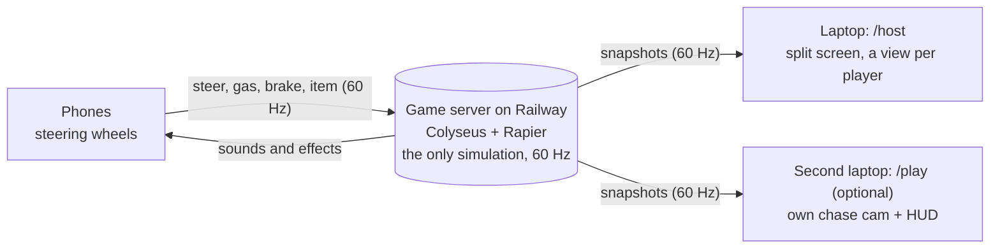

# RaceBall

**Roll a planet around Penn State.** Your phone is the steering wheel, one laptop is the stadium screen, and up to eight planets race through a 3D Happy Valley.

Built at **HackPSU Fall 2026**. The theme is space, so every racer is a planet, the road is scattered with gold stars, and the track runs past Old Main, the Lion Shrine, the Creamery and Beaver Stadium.

**Play:** open [raceball-hw9w.vercel.app/host](https://raceball-hw9w.vercel.app/host) on a laptop and scan the QR code with your phone. To practise alone with a keyboard, open [/play?local=1](https://raceball-hw9w.vercel.app/play?local=1).

## Demo

[](https://www.youtube.com/watch?v=_1BuCD5iqxc)

Watch the demo on YouTube: [youtube.com/watch?v=_1BuCD5iqxc](https://www.youtube.com/watch?v=_1BuCD5iqxc)

## Inspiration

We know many kids don't have a console at home, but a laptop and a phone are readily available. We tried to emulate the experience of playing racing games like Gran Turismo and Need for Speed with just a laptop and a phone, and that is how this idea came about.

## All you need is one laptop and your phone

- **One laptop** (on a TV or projector if you have one) opens `/host`. It shows the room code and a QR code.
- **Every player scans the QR code with their phone.** There's no app to install, no account and no controller to buy.
- **The host can race too, and bots fill empty slots,** so one laptop and one phone is already a race.
- **Have a second laptop?** Pair your phone with it to get your own chase camera and HUD.

## Space, meet Happy Valley

- **Eight planets for eight players:** Mercury, Venus, Earth, Mars, Jupiter, Saturn, Uranus and Neptune, each with an orbit ring in its player's color. A planet can only race once per room.
- **Gold stars:** grab them along the road. Each one raises your top speed a little (+12% with ten), but a hard bump, a Lion Roar or a fall knocks them loose.
- **The Happy Valley Grand Prix:** one lap of a toy-sized campus. Start under Old Main, weave down Pollock Road through the item boxes, and bounce down the Pattee Library steps. Round the Lion Shrine hairpin (or take the jump), roll up the Creamery's giant cone, and cross Beaver Stadium. Then slide through the snowy Arboretum under Mount Nittany and boost down College Avenue to the finish.

### Items

Drive through a yellow item box to get one, then shake the phone or tap to use it.

| Item                   | What it does                                                                       |
| ---------------------- | ---------------------------------------------------------------------------------- |
| **Blue & White Boost** | A burst of speed, and a higher top speed for 2.5 s                                 |
| **Lion Roar**          | A shockwave that throws every planet within 6 m away from you, strongest up close  |
| **Creamery Spill**     | Drops a melted ice-cream puddle behind you for 10 s. Anyone who rolls in slides    |
| **Snow Day**           | Everyone ahead of you slows to 70% of their top speed for 3 s                      |

Item odds depend on your place. The leader gets defensive items, and the back of the pack gets the comeback items, so races stay close.

On the road there are also boost pads that launch you, Lion Paw bumpers that kick you away, and slippery ice and ice cream, plus snow that slows you down. Brake into a turn at speed and your planet drifts round it.

## Built for everyone

- **Any grip:** calibration takes two steps and about 5 seconds, and fits however you hold the phone.
- **Settings on the phone:** auto-gas, steering sensitivity and dead zone.
- **Not just color:** every player has a color and a shape.
- **Captions** on the big screen for the key sounds.
- **Reduced motion** turns off camera shake and the countdown swoop.
- **A steady controller:** the phone's layout never flips to portrait mid-race, however hard you steer.
- **Works on any phone:** feedback is sound and visuals, so no vibration is needed.

## Real 3D, real physics

- **A full 3D world in the browser:** a textured road, sky, landmarks we modeled ourselves, particle effects, and a split screen with a first-person view for every player.
- **Every planet is a real rolling ball,** with momentum, ramps, banked turns and jumps. You can bump rivals off the edge.
- **One server runs the only simulation,** 60 times a second, so every screen agrees. Your own planet is drawn slightly ahead, so steering feels instant.

## How it works



- **Phones only send input,** and screens only draw what the server sends. A screen can even reload mid-race.
- **Snapshots are packed into integers:** 8 planets take about 330 bytes, around 19 KB/s per screen.
- **One shared TypeScript package** holds every message type, with a protocol version. An outdated screen asks you to refresh instead of breaking.

## Tech stack

| Part                       | Tech                                                                   |
| -------------------------- | ---------------------------------------------------------------------- |
| Language                   | TypeScript everywhere, in a pnpm workspaces monorepo                   |
| 3D and UI                  | Babylon.js 9, with React 19 drawing the menus and HUD over the canvas  |
| Physics                    | Rapier (WebAssembly): the same code runs on the server and in browsers |
| Multiplayer                | Node.js 24 + Colyseus                                                  |
| Phone controller           | Vite + TypeScript and the phone's motion sensors, no framework         |
| Map and models             | Blender with our own Python generators, exported to glTF, compressed with gltf-transform |
| Music, sound and particles | Generated by our own scripts in `tools/`, with no samples              |
| Hosting                    | Vercel (web and phone), Railway (server)                               |
| Quality                    | Vitest, ESLint, Prettier                                               |

## Repo

```
apps/web            the big screen (/host) and the laptop player view (/play)
apps/pad            the phone controller
apps/server         Colyseus rooms and the 60 Hz loop
packages/shared     the protocol: the contract every app shares
packages/game-core  physics, track loading, race rules, items
tools/              Blender, audio and particle generators
```

## Run it locally

You need Node.js 24 with Corepack (`corepack enable`).

```bash
pnpm install
pnpm dev        # web :5173, phone :5174, server :2567
```

- **Practice with a keyboard:** open `localhost:5173/play?local=1`. The keys are W accelerate, A/D steer, S brake, Space item, R reset and V overview.
- **Race for real:** open `localhost:5173/host`. Phones need HTTPS, so follow [ONBOARDING.md](docs/ONBOARDING.md#5-test-on-your-own-phone) to tunnel to them.
- **Before a PR:** run `pnpm typecheck`, `pnpm lint` and `pnpm test`.

## How we work

1. One branch per task, named `<name>/<topic>`, and a pull request from the template.
2. Typecheck, lint, formatting and tests pass. A teammate reviews, then we squash-merge.
3. Merging to `main` deploys by itself: Railway rebuilds the server, and Vercel publishes the web and phone apps.
4. A protocol change bumps `PROTOCOL_VERSION`, and the server deploys first.

Details are in [WORKFLOW.md](docs/WORKFLOW.md), and the task list is in [TASKS.md](TASKS.md).

## Docs

| Doc                                      | What's in it                                         |
| ---------------------------------------- | ---------------------------------------------------- |
| [ONBOARDING.md](docs/ONBOARDING.md)      | Day one: tools, running the project, testing on your phone |
| [WORKFLOW.md](docs/WORKFLOW.md)          | Git, PRs, protocol changes, conventions, deploying   |
| [ARCHITECTURE.md](docs/ARCHITECTURE.md)  | Roles, netcode, the protocol, hosting and costs      |
| [CONTROLLER.md](docs/CONTROLLER.md)      | Phone sensors, calibration, the rotation fix         |
| [MAP.md](docs/MAP.md)                    | The Happy Valley Grand Prix: route, landmarks, items |
| [ASSETS.md](docs/ASSETS.md)              | Art bible, the asset pipeline, budgets, credits      |
| [DEMO.md](docs/DEMO.md)                  | Demo setup, script and checklists                    |

## Team

| Who       | Built                                                                              |
| --------- | ---------------------------------------------------------------------------------- |
| **Ali**   | Physics and race rules, the track and its markers, items, cameras, the Railway server |
| **Rasim** | The monorepo, server rooms and netcode, the phone controller, Vercel               |
| **Nuris** | Art direction, landmarks, planets, effects, music and sound, UI and branding       |

Each person's guide is in [docs/team](docs/team).

## License

Code is under the [MIT License](LICENSE). Every third-party asset and its license is listed in [ASSETS.md](docs/ASSETS.md#credits).

RaceBall is a student hackathon project. It is not affiliated with or endorsed by Penn State, and it doesn't use official Penn State logos ([trademark note](docs/MAP.md#trademark-note)).
