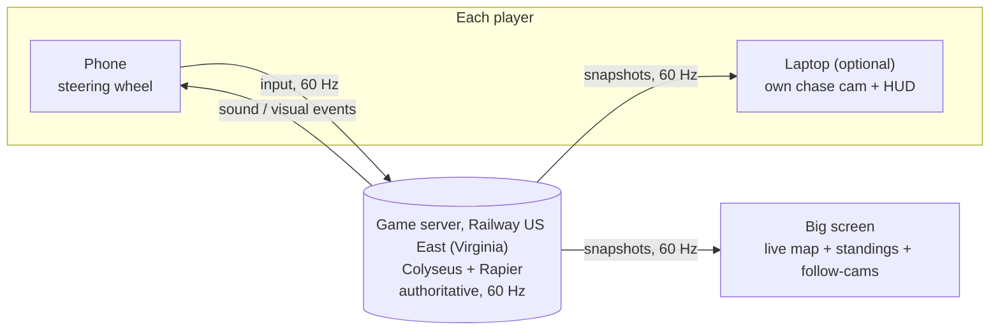

# RaceBall

**Mario Kart, but you *are* the ball.** Hold your phone like a steering wheel, roll through a toy-sized Penn State campus, shake to fire items, and bump your friends off the course.

Built at **HackPSU Fall 2026** for the General Track, *The Mystery Stack*: phone motion, rivalry, group play (4–8 players).

> **Status: M0 in progress.** The monorepo, server, pad and `game-core` are in. What's left is in [TASKS.md](TASKS.md).
>
> **Live:** web [raceball-web-delta.vercel.app](https://raceball-web-delta.vercel.app) (local mode at `/play?local=1`), pad [raceball-delta.vercel.app](https://raceball-delta.vercel.app), server `wss://raceball-server-production.up.railway.app` ([health](https://raceball-server-production.up.railway.app/health)).
>
> **New to the team? Start with [docs/ONBOARDING.md](docs/ONBOARDING.md).**

## Docs

| Doc | What's in it |
|---|---|
| [docs/ONBOARDING.md](docs/ONBOARDING.md) | Day one: accounts, tools, running the project, testing on your phone |
| [docs/WORKFLOW.md](docs/WORKFLOW.md) | Git, PRs, the protocol change process, shared conventions, deploying |
| [TASKS.md](TASKS.md) | Decisions, milestones, per-person checklists |
| [docs/team/ali-game.md](docs/team/ali-game.md) | **Ali's guide:** physics, race rules, track loading, 3D scene, cameras, items, 3D models |
| [docs/team/rasim-platform.md](docs/team/rasim-platform.md) | **Rasim's guide:** monorepo, server, hosting, netcode, phone controller |
| [docs/team/nuris-art-ui.md](docs/team/nuris-art-ui.md) | **Nuris's guide:** art bible, VFX, audio, UI, branding |
| [docs/ARCHITECTURE.md](docs/ARCHITECTURE.md) | Roles, netcode, latency and how to cut it, protocol, hosting and costs |
| [docs/CONTROLLER.md](docs/CONTROLLER.md) | Phone controller: sensors, calibration, the screen-rotation fix, iPhone vs Android |
| [docs/ASSETS.md](docs/ASSETS.md) | Art bible, importing assets and editing the scene, pipeline, budgets, licenses |
| [docs/MAP.md](docs/MAP.md) | The Happy Valley Grand Prix: route, landmarks, themed items and skins |
| [docs/DEMO.md](docs/DEMO.md) | Demo setup, script, checklists, what to do if something breaks |

---

## How a match works

1. **Big screen** (the host laptop, or a monitor or projector) opens `/host`, which creates a room and shows the room code plus a "join with just your phone" QR code.
2. **Players with a laptop** open `/play` on it, enter the code, pick a name and ball, then scan the **pairing QR** on their laptop with their phone.
3. **Players with only a phone** scan the big screen's QR code. They play by watching the big screen, which gives them a name tag and a follow-cam tile.
4. Each phone becomes a steering wheel. Calibrate (hold level, then turn right) and tap **Ready**.
5. Countdown, then 3 laps around **Happy Valley**:
   - Laptop players see their own chase camera.
   - The big screen shows everyone: live map, standings and battles.
6. Podium, stats and a brag card, then rematch.

## What we're doing differently

- **The ball is the kart:** real rolling physics, momentum, ramps, and bumping rivals off edges.
- **Penn State, toy-sized:** a stylized campus track (Old Main, the Lion Shrine, the Creamery, Beaver Stadium) with themed items and balls.
- **Two-screen design:** a personal view on your laptop, plus a shared "broadcast" big screen. No cramped split screen, and you don't even need a laptop.
- **Rotation-proof controller:** the phone UI never flips to portrait mid-race ([how](docs/CONTROLLER.md#fixing-the-screen-rotation-problem)).
- **One art direction, end to end:** coherent models, materials, VFX, animation and sound, from lobby to podium.
- **Accessibility:** calibrates to any grip, plus sensitivity, auto-gas, a color + shape for each player, and captions for audio cues.

## Architecture



- The **server runs the only physics simulation**. Phones send inputs, and screens draw what the server says, so there's no desync.
- Screens **interpolate** between snapshots, so motion is smooth. Your own ball is drawn slightly ahead using its velocity, so steering feels instant.
- Expected delay is **about 70–100 ms** from tilting the phone to seeing it on screen, with ways to go lower ([details](docs/ARCHITECTURE.md#how-to-cut-delay)).

## Tech stack

| Layer | Choice | Why |
|---|---|---|
| Language | **TypeScript** everywhere | One language for game, server and controller. Shared protocol types catch mismatches at compile time |
| Repo | **pnpm workspaces** monorepo | One `pnpm dev` runs everything, and packages share code without publishing |
| 3D engine (laptops + big screen) | **Babylon.js** (decided) | A full web engine for an asset-heavy game: imports **glTF/GLB, OBJ, STL**, PBR materials, Node Material Editor, CPU/GPU particles, animation groups, spatial audio, post-processing, shadows, LOD, plus the live **Inspector** for editing the scene in the browser |
| Scene / level editing | **Blender** as the level editor + Babylon Inspector | The whole map (track, landmarks, gameplay markers) lives in one Blender file and exports to glTF ([workflow](docs/ASSETS.md#importing-assets-and-editing-the-scene)) |
| UI (lobby, HUD, menus, results) | **React** + CSS, drawn as DOM over the canvas | Fast to style and iterate on, and keeps UI work separate from 3D work |
| Physics | **Rapier** (`@dimforge/rapier3d-compat`) in `packages/game-core` | Fast WASM physics that runs in Node (the server) and in browsers (for client-side prediction). Good rolling-ball behavior |
| Game server | **Node.js 24 LTS + Colyseus** | Built for authoritative multiplayer: rooms, join by ID, reconnection, binary state sync and a fixed simulation loop |
| Phone controller | **Vite + TypeScript**, no framework | Tiny bundle that loads in seconds on a phone. Uses DeviceMotion, Pointer Events and Wake Lock. No vibration: feedback is sound + visuals on every phone |
| Asset pipeline | **Blender, then glTF (.glb), then `gltf-transform`** (Meshopt + KTX2/WebP) | Smaller downloads and less GPU memory. Babylon loads all of these natively |
| Hosting | **Vercel** for web + pad. **Railway, US East (Virginia)** for the server | Phones need HTTPS for motion sensors. Vercel can't hold WebSockets, so the server runs on Railway in Virginia, close to State College. Railway redeploys automatically on every push to `main` |
| Dev tunnel | **cloudflared** quick tunnels | HTTPS URLs to your laptop so real phones can test |
| Quality | ESLint + Prettier, Vitest (for `game-core`) | Consistent code, and fast tests for the physics and race logic |

**Why not Unity?**

- The phone controller and lobby have to be web pages anyway.
- Unity web builds take minutes to rebuild and are heavy to load.
- Unity's WebGL builds can't open sockets directly.
- Babylon covers what Unity is usually picked for: assets, materials, particles, animation and an inspector.

## Hosting and costs

| What | Where | Cost |
|---|---|---|
| Web + pad | Vercel Hobby (free plan, non-commercial use) | **$0** |
| Game server | Railway, 1 service (target: always on, US East Virginia) | **Free plan for now** ($0, $1 of usage a month; the server sleeps when idle and runs in `sfo`). Switch to **Hobby, $5/month** (includes $5 of usage) before the M1 latency measurement and the event. Delete the project after the event |
| Alternative server | Fly.io, region `iad` (Ashburn, VA). Card required, no free plan for new accounts | About $2–4/month (third-party estimates) |
| Dev-only server | Render free plan (sleeps after 15 min idle, small CPU) | $0 |
| Engine, physics, server framework | Babylon.js (Apache-2.0), Rapier (Apache-2.0), Colyseus (MIT) | $0 |
| Art | Blender, CC0 asset packs | $0 |
| Optional | Custom domain (otherwise free `*.vercel.app` / `*.up.railway.app`); a Wi-Fi 6 travel router for the demo | About $10–15/year; about $30–60 one-time |

**Total: roughly $0–5**, plus optional hardware. Full breakdown in [docs/ARCHITECTURE.md](docs/ARCHITECTURE.md#hosting-and-costs).

## Repo layout (planned)

```
raceball/
├─ apps/
│  ├─ web/        # big screen (/host) + player view (/play): React UI + Babylon.js canvas
│  │  ├─ src/game/   # Babylon scene, cameras, VFX hooks          (Ali)
│  │  ├─ src/net/    # connection, snapshot buffer, interpolation (Rasim)
│  │  ├─ src/ui/     # lobby, HUD, big-screen map, results        (Nuris)
│  │  └─ public/assets/  # optimized runtime assets: models (Ali), fx/sfx/mus/ui (Nuris)
│  ├─ pad/        # phone controller: tiny, fast-loading            (Rasim logic, Nuris style)
│  └─ server/     # Colyseus rooms + 60 Hz simulation loop          (Rasim)
├─ packages/
│  ├─ shared/     # protocol types + constants: THE CONTRACT        (Rasim, everyone reviews)
│  └─ game-core/  # Rapier sim: ball control, track loading, checkpoints, laps, items (Ali)
│     └─ tracks/  # happy_valley_col.glb: collision + gameplay markers
├─ docs/
└─ railway.json   # server hosting config
```

Raw art sources (`.blend`, `.psd`, `.wav`) live in the shared Drive folder `RaceBall/assets-src/`, not in git.

## Getting started

The full day-one guide is in **[docs/ONBOARDING.md](docs/ONBOARDING.md)**. The short version:

### Prerequisites

- **Node.js 24 LTS**, with pnpm through Corepack: `corepack enable`
- **Git**
- **cloudflared**, for HTTPS tunnels to phones
- **Blender 4.x** (for art and the map) and the **gltf-transform CLI**: `npm i -g @gltf-transform/cli`
- Test phones: at least **one iPhone (Safari)** and **one Android phone (Chrome)**

### Bootstrap (milestone M0, done once by Rasim)

```bash
git clone https://github.com/raceball/raceball && cd raceball
corepack enable
pnpm init
printf 'packages:\n  - "apps/*"\n  - "packages/*"\n' > pnpm-workspace.yaml

pnpm create vite apps/web --template react-ts
pnpm create vite apps/pad --template vanilla-ts
npm create colyseus-app@latest apps/server   # then delete its package-lock.json and use pnpm
mkdir -p packages/shared/src packages/game-core/src packages/game-core/tracks

# give every package.json a scoped name: @raceball/web, @raceball/pad, @raceball/server,
# @raceball/shared, @raceball/game-core. Then:
pnpm --filter @raceball/web add @babylonjs/core @babylonjs/loaders qrcode
pnpm --filter @raceball/web add -D @babylonjs/inspector lil-gui
pnpm --filter @raceball/game-core add @dimforge/rapier3d-compat @gltf-transform/core gl-matrix
pnpm --filter @raceball/server add @raceball/game-core@workspace:* @raceball/shared@workspace:*
```

The remaining setup (tsconfig, scripts, lint, Vercel settings) is in [Rasim's guide](docs/team/rasim-platform.md#m0-setup). Railway hosting is in [Ali's guide](docs/team/ali-game.md#6-deploying-the-server-to-railway).

### Run locally

```bash
pnpm install
pnpm dev        # web :5173, pad :5174, server :2567 (Colyseus default)
```

### Test on real phones (HTTPS required)

```bash
cloudflared tunnel --url http://localhost:5174   # pad
cloudflared tunnel --url http://localhost:2567   # server (WebSocket works through it)
```

Put the server tunnel URL in `apps/pad/.env.local` and `apps/web/.env.local` as `VITE_SERVER_URL=wss://<random>.trycloudflare.com`. Details are in [ONBOARDING.md](docs/ONBOARDING.md#5-test-on-your-own-phone).

## Team and ownership

| Who | Owns | Main folders | Guide |
|---|---|---|---|
| **Ali** | **Game:** physics and gameplay, track loading, race rules, 3D scene, cameras (incl. big-screen follow-cams), items, map greybox + gameplay markers, most 3D models (planets 1–4, the dressing kit, the landmarks a ball touches) and their pipeline, wiring art/VFX/audio to events, Railway hosting | `packages/game-core`, `apps/web/src/game`, `railway.json` | [ali-game.md](docs/team/ali-game.md) |
| **Rasim** | **Platform + controller:** monorepo, server code, Vercel settings, rooms, pairing, phone-only join, netcode, the phone controller and the rotation fix | `apps/server`, `apps/pad`, `packages/shared`, `apps/web/src/net` | [rasim-platform.md](docs/team/rasim-platform.md) |
| **Nuris** | **Art direction, audio + UI:** art bible (and reviewing models against it), particles, sound, the event-to-effect table, planets 5–8, animated props, Beaver Stadium + Mount Nittany models, lobby/HUD/big-screen UI, pad look, branding | `apps/web/public/assets`, `apps/web/src/ui`, `apps/pad/src/style.css` | [nuris-art-ui.md](docs/team/nuris-art-ui.md) |

How we work together (branches, PRs, conventions, protocol changes) is in **[docs/WORKFLOW.md](docs/WORKFLOW.md)**.

## Demo

Judging is a **table presentation** with **2 laptops and 4 phones**, and demo races are **1 lap**. The setup, script and checklists are in **[docs/DEMO.md](docs/DEMO.md)**. Judges just pick up a phone (or scan the QR with their own). No app install.

## License and credits

Code is under the [MIT License](LICENSE). Every third-party asset is listed with its license in [docs/ASSETS.md](docs/ASSETS.md#credits).

RaceBall is a student hackathon project. It is not affiliated with or endorsed by Penn State, and it doesn't use official Penn State logos (see [docs/MAP.md](docs/MAP.md#trademark-note)).
