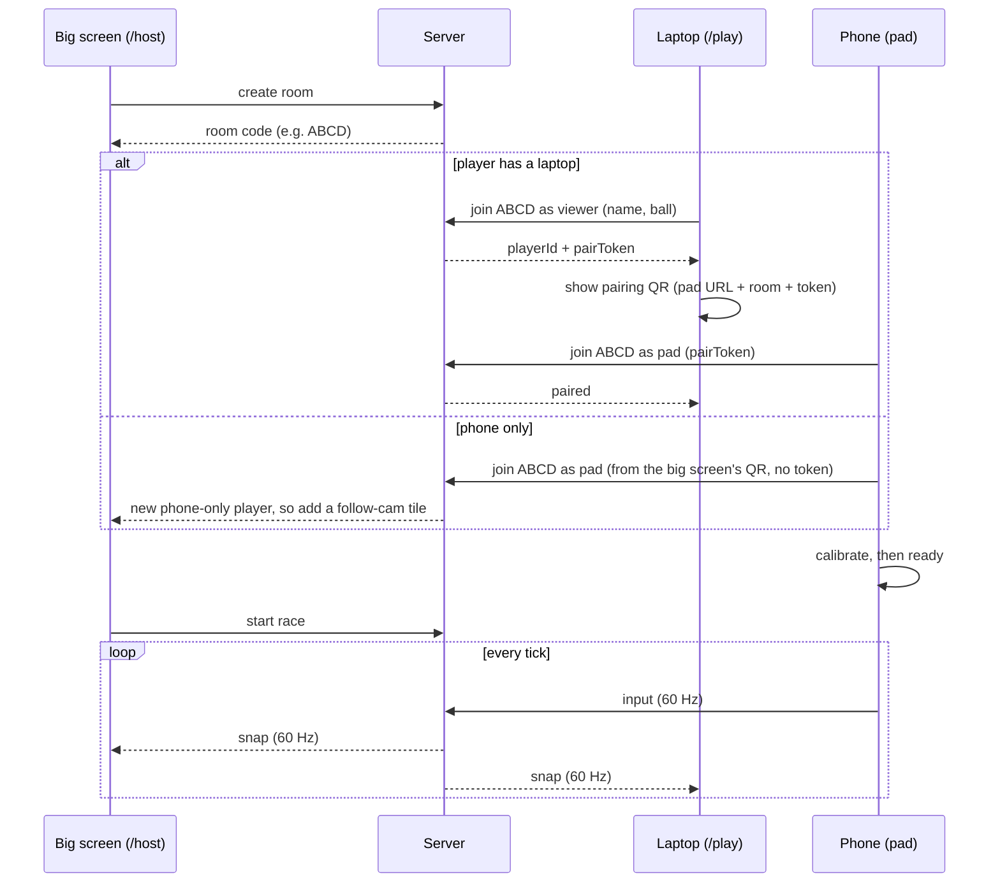
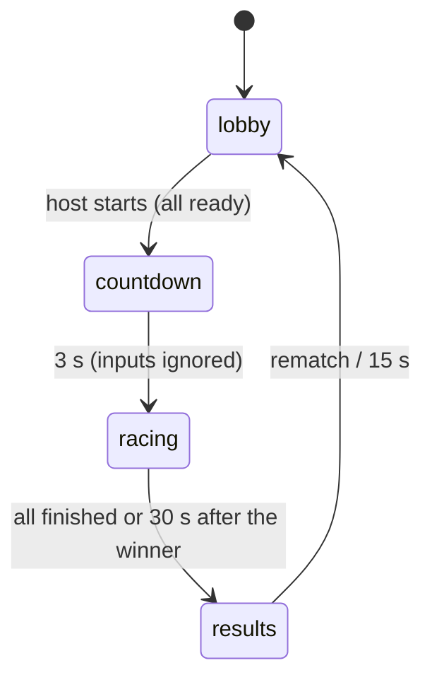

# Architecture and netcode

## Roles

| Role | Runs on | Does |
|---|---|---|
| **host** | The big-screen laptop (or a monitor/projector), `/host` | Creates the room and shows the code + the phone-only QR code. During the race, **splits the screen into a first-person view per player** (up to 8), and shows results |
| **viewer** | A player's laptop, `/play` (optional) | Joins with name and ball, shows the pairing QR code, renders that player's chase camera and HUD |
| **pad** | Each player's phone (`apps/pad`) | Reads sensors and touch, sends input, plays sounds and visual feedback. A phone-only player's pad also shows position, lap and item |
| **server** | Railway, US East (Virginia) | Runs the **only** physics simulation, and sends snapshots and events |

## Join and pairing flow



A phone-only player picks their name and ball on the pad itself. During the race the big screen is a **split screen**: one first-person view per player, up to 8 (1 fills the screen, 2 side by side, 3–4 in 2×2, 5–8 in two rows). If the big screen drops below 50 fps for 3 s, it falls back to the overview camera with a name tag on every ball. This is a performance safety valve, since every view draws the scene again.

## The server is authoritative

- Only the server runs physics (`game-core` with Rapier), at a fixed **60 Hz** (`setSimulationInterval`).
- Pads only send input. Laptops and the big screen only render snapshots.
- Why:
  - There's one truth, so nothing gets out of sync across up to 9 screens.
  - A screen can stutter or reload without affecting the race.
  - Browsers throttle background tabs, but a server keeps ticking.
- Colyseus rooms live in memory on one process, so **run exactly one server instance** with no autoscaling.

## Track data: one source of truth

- The map is built in Blender ([workflow](ASSETS.md#importing-assets-and-editing-the-scene)) and exported twice:
  - `apps/web/public/assets/maps/happy_valley.glb`: the visuals, loaded by the host and viewers.
  - `packages/game-core/tracks/happy_valley_col.glb`: simple collision meshes + gameplay markers (spawns, checkpoints, respawn points, item boxes, boost pads, surfaces, overview cameras), loaded by the **server**. It's small, so it lives next to the code that reads it.
- `game-core` exposes `loadTrack(bytes)`, which uses `@gltf-transform/core` to build Rapier trimesh colliders and read the markers from node extras.
- Dynamic objects (item boxes, puddles) go out to screens through the schema state, so their positions are never duplicated in client code.

## Data flow and rates

| Message | Direction | Rate | Notes |
|---|---|---|---|
| `input` | pad → server | 60 Hz, plus immediately on any button change | Latest wins. The server drops older `seq` values |
| *(schema state)* | server → all | Colyseus patches (~20 Hz) | Lobby and race state: players, ready, lap, place, phase, countdown, item boxes |
| `snap` | server → host + viewers | **60 Hz** (start at 30 Hz while debugging) | Ball transforms go in this custom message, **not** in the schema |
| `evt` | server → pad + viewer + host | On event | bump / item / fire / overtake / lap / finish / respawn, for pad sounds and visuals, screen VFX and standings animations |
| `ping` / `pong` | both ways | 1 Hz | Measures round-trip time and the server clock offset |
| `start { laps }`, `addBot`, `removeBot { id }`, `rematch` | host → server | On click | Only the host may send these. `laps` is 1 (demo) or 3 (default). `start` only works in the lobby once every player is `readyToRace()` |
| `status { calibrated?, assetsLoaded?, ready? }` | pad / laptop → server | On change | For the sender's own player. Phone-only players have no assets to load |
| `setProfile { name?, ball? }` | pad / laptop → server | Lobby | Name and planet for the sender's own player. Each planet at most once per room: a taken one is refused, a missing one gets the first free planet |

- **Stale input rule:** if a pad's latest input is older than **200 ms**, treat it as neutral (no gas). Then a locked phone can't send its ball off a cliff.
- **Bandwidth:** 8 balls × ~40 bytes × 60 Hz ≈ 20 KB/s per screen. That's not a concern.

## Smooth rendering

- Every screen keeps a **snapshot buffer**:
  - **Other balls:** render about 1.5–2 snapshot intervals in the past (~25–33 ms at 60 Hz). Interpolate position with lerp and rotation with slerp.
  - **Your own ball:** render it *ahead* using its velocity (dead reckoning), so steering feels immediate. When a new snapshot disagrees, blend the correction in over about 100 ms instead of snapping.
- Estimate the server clock offset with pings (NTP-style), so interpolation runs on server time.
- The render loop runs at the display rate regardless of the network rate.

## Latency budget (estimates, so measure your own)

| Stage | Baseline (Tier 1) |
|---|---|
| Sensor event | ≤ 16 ms |
| Waiting for the pad's next send (60 Hz) | ≤ 16 ms |
| Phone → Railway US East, one way (Wi-Fi + internet) | 10–30 ms |
| Waiting for the next sim tick (60 Hz) | ≤ 16 ms |
| Waiting for the next snapshot (60 Hz) | ≤ 16 ms |
| Railway US East → laptop, one way | 10–30 ms |
| Interpolation (own ball: ~0 with extrapolation) | 0–33 ms |
| Render frame | ≤ 16 ms |
| **Typical total, phone tilt → own screen** | **~70–100 ms** |

A rolling ball has momentum, which hides latency far better than a twitchy kart does. Target **p95 < 120 ms** on the demo network.

## How to cut delay

**Tier 1: built in (M1–M3)** · target ~70–100 ms
1. **Server close to us:** Railway US East (Virginia).
2. **60 Hz everything:** pad sends, server ticks, snapshots.
3. **Own-ball extrapolation**, plus an interpolation buffer sized from the measured jitter instead of a fixed delay.
4. **Send on change:** the pad sends immediately on any button press, not just on the timer.
5. **Filter on the phone:** a One Euro filter, tuned for low lag.
6. **Our own network for the demo:** a Wi-Fi 6 travel router on 5 GHz (uplink: venue ethernet or a phone hotspot). That beats a hackathon network shared by hundreds of people.
7. **Physics tuned for feel:** smooth heading turn rates hide the latency that remains.

**Tier 2: client-side prediction (stretch)** · own ball reacts in ~20–40 ms
- The laptop runs `game-core` for **its own ball** with that player's inputs, so it reacts instantly. Server snapshots correct it by replaying the inputs the server hasn't acknowledged yet.
- For the laptop to get inputs before the server does, the phone also sends input **straight to its paired laptop** over a WebRTC data channel (unordered, no retransmits), set up through the server.
- If the direct link fails (some networks block device-to-device traffic), the server relays the input to the laptop instead. That's still faster than waiting for snapshots.
- This is the biggest improvement to how the game feels, and also the most work. Only start it after M2.

**Tier 3: LAN server (stretch, small gain)** · saves ~20–40 ms of internet round trip
- Run the server on a team laptop connected to our own router.
- The catch: phones need **HTTPS/WSS with a trusted certificate**, so the LAN server needs a real domain pointing at its LAN IP, plus a certificate obtained through a DNS challenge. Some routers block domains that point at private IPs.
- Only worth it if Tier 1 measurements are bad.

## Measuring (build this in M1)

- A **net HUD** on web and pad, toggled with the `~` key or `?debug=1`. It shows round-trip time, jitter, snapshot rate, input age at the server, and fps.
- Log p50/p95 round-trip time per client. Record the numbers in TASKS.md once M1 is done.

## Protocol v1 (draft, lives in `packages/shared/src/protocol.ts`)

```ts
export const PROTOCOL_VERSION = 4;

export type Role = "host" | "viewer" | "pad";
export type Phase = "lobby" | "countdown" | "racing" | "results";
export type ItemId = "boost" | "roar" | "spill" | "snowday";

/** Options sent when joining a room */
export interface JoinOptions {
  role: Role;
  protocol: number;    // must equal PROTOCOL_VERSION, or the server rejects with "please refresh"
  name?: string;       // viewer, or a phone-only pad
  ball?: string;       // skin id
  pairToken?: string;  // pad: from a laptop's QR code. Absent = phone-only player
  playerId?: string;   // reconnecting into the same slot
}

/** pad → server: every 16 ms (latest wins) and on any button change */
export interface InputMsg {
  seq: number;    // +1 per message
  steer: number;  // -1 full left … 1 full right (already filtered, dead-zoned, curved)
  gas: number;    // 0 … 1 (held right thumb)
  brake: boolean;
  item: boolean;  // true in exactly one message when a shake/tap fires the item
}

/** server → host + viewers: 60 Hz */
export interface SnapMsg {
  tick: number;
  t: number;          // server time in ms
  balls: BallSnap[];
}
export interface BallSnap {
  id: string;
  p: [number, number, number];          // position (m)
  q: [number, number, number, number];  // rotation quaternion
  v: [number, number, number];          // velocity (m/s), used for extrapolation
  h: number;                            // heading (rad), used by the chase camera
}

/** server → pad + viewer + host */
export type GameEvent =
  | { type: "bump"; a: string; b: string; strength: number }  // strength 0 … 1
  | { type: "item"; player: string; item: ItemId } // picked up from an item box
  | { type: "fire"; player: string; item: ItemId; pos: [number, number, number] } // used; pos = where it happens (the puddle for a spill)
  | { type: "overtake"; player: string; passed: string; section: string } // position change
  | { type: "lap"; player: string; lap: number }
  | { type: "finish"; player: string; place: number }
  | { type: "respawn"; player: string };

/**
 * Which player slot is yours. Send "hello" (no payload) once your message handlers are
 * registered, and the server answers with "welcome". Asking avoids losing a message sent
 * before the client is listening.
 */
export interface WelcomeMsg {
  playerId: string;
  /** Viewer only: goes in the pairing QR (see padUrl) */
  pairToken?: string;
}

/** Close/reject codes the server uses, so clients can show the right error screen */
export const JoinError = {
  VersionMismatch: 4001,
  BadRole: 4002,
  HostTaken: 4003,
  RoomFull: 4004,
  BadPairToken: 4005,
  AlreadyPaired: 4006,
} as const;

/**
 * Clock sync, 1 Hz. Any client sends "ping" with its performance.now() as the payload;
 * the server answers "pong" with that value echoed back and its own clock.
 */
export interface PongMsg {
  /** The client's timestamp from the ping, echoed back */
  c: number;
  /** Server time in ms (same clock as SnapMsg.t) */
  s: number;
}

/** server → a player's pad and laptop, 1 Hz: numbers for the net HUD */
export interface NetStatMsg {
  /** How old this player's latest input is at the server, ms. 200+ means it's treated as neutral */
  inputAge: number;
}

/** Race lengths the host can pick: 1 for the demo, 3 by default */
export type Laps = 1 | 3;

/** host → server: "start". Allowed in the lobby once every player is readyToRace() */
export interface StartMsg {
  laps: Laps;
}

/** host → server: "removeBot". ("addBot" and "rematch" have no payload) */
export interface RemoveBotMsg {
  id: string;
}

/**
 * pad or laptop → server: "status", for its own player. Send only what changed.
 * calibrated: the pad finished calibrating. assetsLoaded: the laptop finished preloading.
 * ready: the player tapped Ready (pad or laptop).
 */
export interface StatusMsg {
  calibrated?: boolean;
  assetsLoaded?: boolean;
  ready?: boolean;
}

/**
 * pad or laptop → server: "setProfile", for its own player, in the lobby.
 * A phone-only player picks their name and planet on the pad. A taken planet is refused.
 */
export interface SetProfileMsg {
  name?: string;
  /** One of PLANETS */
  ball?: string;
}
```

Colyseus schema (synced automatically):

```
RaceState  { phase, laps, countdownEndsAt, trackId, players: Map<playerId, PlayerState>, itemBoxes: ItemBox[], puddles: Puddle[] }
PlayerState{ name, ball, color, shape, phoneOnly, bot, paired, calibrated, assetsLoaded, ready,
             lap, checkpoint, place, finishedAt, connected }
ItemBox    { id, x, y, z, active }   // x, y, z = the box's center; inactive for a few seconds after a hit
Puddle     { id, x, y, z, radius }   // a Creamery Spill on the road, gone after spillSeconds
```

Later, if snapshots need to shrink, quantize them: positions in centimeters as `Int16`/`Int32`, and quaternions in smallest-three form.

## Race state machine



**Ranking:** order by laps, then checkpoints passed, then distance to the next checkpoint. Recompute every tick.

## Asset loading

- The host and viewers **preload all race assets in the lobby**, with a progress bar. The Ready button only enables once the player is loaded, paired and calibrated. Phone-only pads skip the asset step.
- Use hashed file names and CDN caching, so the second load is instant.
- Babylon fetches the Meshopt and KTX2 decoders from its CDN by default. **Self-host them before demo day** in case the Wi-Fi is bad.

## Hosting and costs

| App | Where | Cost | Notes |
|---|---|---|---|
| `apps/web` | Vercel Hobby (root `apps/web`) | $0 | Hobby is for non-commercial use, which covers a hackathon. Env: `VITE_SERVER_URL`, `VITE_PAD_URL` |
| `apps/pad` | Vercel Hobby (root `apps/pad`) | $0 | Env: `VITE_SERVER_URL` |
| `apps/server` | **Railway, US East (Virginia)**, 1 service, 1 replica, built from `apps/server/Dockerfile` | $5 one-time trial credit, then Hobby at $5/month (includes $5 of usage) | Auto-deploys on push to `main`. No sleeping, health check on `/health`. **Delete the project after the event**, or keep it on Hobby |
| Alternative | Fly.io, region `iad` (Ashburn, VA) | About $2–4/month (third-party estimates) | Card required (no free plan for new accounts). Deploys from the CLI (`fly deploy`). The same Dockerfile works |
| Dev only | Render free plan | $0 | Sleeps after 15 min idle, and the CPU is small. Not for the demo |

### Why Railway over Fly.io

| | Railway | Fly.io |
|---|---|---|
| Location | US East, Virginia | `iad`, Ashburn, Virginia |
| Delay from State College | Same (same area) | Same |
| Deploying | **Automatic from GitHub** on every push to `main` (watch paths limit it to server changes) | Manual `fly deploy` from a terminal, unless we add a GitHub Action |
| Setup | Dashboard clicks + our Dockerfile | CLI + `fly.toml` + our Dockerfile |
| Logs and metrics | In the dashboard, which anyone on the project can open | CLI (`fly logs`) or the dashboard |
| Getting started | $5 trial credit | Credit card up front |
| Ongoing cost | $5/month Hobby | About $2–4/month |

For a three-person team that wants to spend time on the game, not on deploys, **Railway wins**. Fly.io is slightly cheaper long-term and gives more control, so it's the fallback if Railway ever causes trouble. Our Dockerfile works on both, so switching takes about 15 minutes.

Everything else is free: Babylon.js, Rapier and Colyseus are open source (Apache-2.0 / Apache-2.0 / MIT), Blender is free, and the asset packs are CC0. Optional extras: a custom domain (~$10–15/year) and a travel router (~$30–60).
