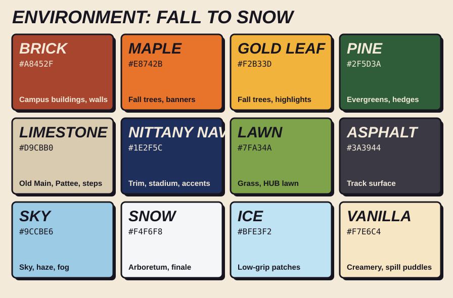
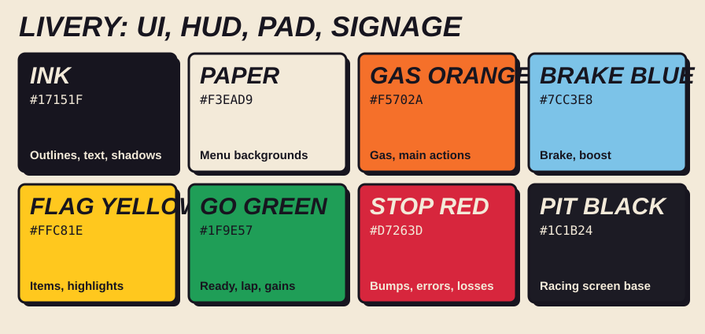
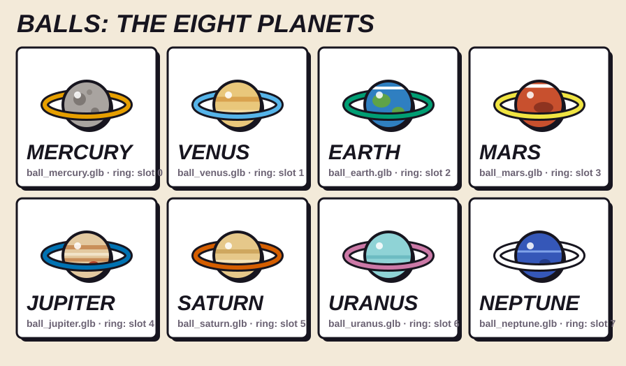
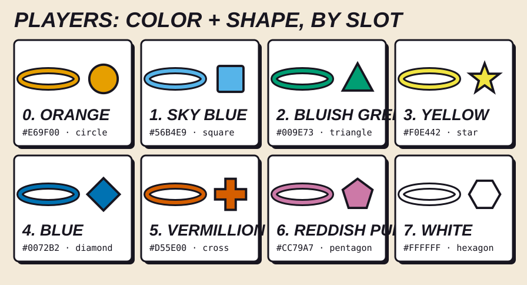

# Assets: art bible and pipeline

Owners: **Nuris** sets the art direction (this art bible) and makes the particles, sounds and UI art. **Ali** builds the 3D models and runs the model pipeline, and Nuris reviews them against the art bible. RaceBall is **asset-heavy** (models, materials, audio, particles, animation), so budgets and a pipeline are decided in M0, not at the end.

## Art bible

**In one line: tiny planets racing across a toy-box Happy Valley on race day.** The balls are the eight planets, a nod to HackPSU's space theme. The campus looks like a painted wooden play set someone built on a table, and the race looks like a real race day: checkered flags, number plates, chevrons and stickers. Everything in the game, on the laptops and on the phones follows this page. If an asset doesn't fit it, it doesn't ship.

Use **original art only**, with no official Penn State logos, wordmarks or athletics marks ([trademark note](MAP.md#trademark-note)).

### Style pillars

1. **Toy, not real.** Chunky shapes, rounded and bevelled edges, flat painted color. A building is a block with a roof, not a scan. Exaggerate proportions: towers taller, cones bigger, doors smaller.
2. **Silhouette first.** Every landmark must be recognizable as a black shape against the sky: Old Main's bell tower, the Lion Shrine's crouching lion, the Creamery cone, the Beaver Stadium bowl. If the silhouette doesn't read, add nothing else until it does.
3. **Race-day livery.** Racing graphics sit on top of the campus: checkered strips, chevrons on boost pads and barriers, number-plate signs, sticker-style banners. The UI uses the same language (ink outlines, hard offset shadows, condensed italic type).
4. **Fall into snow.** Most of the lap is a warm fall afternoon (brick, maple, gold). The Arboretum turns to snow for the finale, so the last third of every lap feels different.
5. **Readable at a table.** Judges see a laptop screen from a meter or two away. Big shapes, strong contrast between the track and everything else, and no detail smaller than the ball.

| Do | Don't |
|---|---|
| Flat colors from the palettes below, one main color per object | Photo textures, noise, grunge, realistic dirt |
| Bevel every hard edge (2–3 cm, 2 segments) so it catches light like a toy | Razor-sharp edges or smooth-shaded blobs |
| Rounded, slightly squashed shapes | Thin poles, wires, fences or text smaller than the ball |
| Dark track (asphalt) against bright surroundings | Track the same color as the ground around it |
| Original lion, original campus shapes | The official Nittany Lion logo, wordmarks, real brand signs |
| Cartoon puffs, stars and leaves for effects | Realistic smoke, fire or lens flares |

### Environment palette

The campus, track and props use these colors through the shared palette texture (see [Track dressing kit](team/ali-game.md#m1-track-dressing-kit)). The first six are the main palette; the rest are supporting colors.



| Color | Hex | Used for |
|---|---|---|
| Brick | `#A8452F` | Campus buildings, walls |
| Maple | `#E8742B` | Fall trees, banners |
| Gold leaf | `#F2B33D` | Fall trees, highlights |
| Pine | `#2F5D3A` | Evergreens, hedges |
| Limestone | `#D9CBB0` | Old Main, Pattee Library, steps |
| Navy | `#1E2F5C` | Trim, the stadium, accents |
| Lawn | `#7FA34A` | Grass, the HUB lawn |
| Asphalt | `#3A3944` | The track surface |
| Sky | `#9CCBE6` | Sky, haze, fog |
| Snow | `#F4F6F8` | The Arboretum and the finale |
| Ice | `#BFE3F2` | Low-grip patches |
| Vanilla | `#F7E6C4` | The Creamery, spill puddles |

**Each section has a color key,** so players know where they are at a glance:

| Section | Dominant colors |
|---|---|
| Start / finish (Old Main) | Limestone, navy, checkered black and white |
| Pollock Road (HUB) | Brick, lawn, maple |
| Library steps (Pattee) | Limestone, gold leaf |
| Lion Shrine hairpin | Limestone rock, pine hedges |
| Creamery run | Vanilla, chocolate brown, sprinkle colors from the livery palette |
| Beaver Stadium | Navy, white, asphalt |
| Snowy Arboretum | Snow, ice, pine |
| College Avenue | Brick, gold leaf, warm window light |

### Livery palette (UI, HUD, phone controller, signage)

These are the colors in [`apps/pad/src/style.css`](../apps/pad/src/style.css). The in-world signage, boost pads and item boxes use them too, so the game and the UI match.



| Color | Hex | Used for |
|---|---|---|
| Ink | `#17151F` | Outlines, text, hard shadows |
| Paper | `#F3EAD9` | Menu backgrounds |
| Gas orange | `#F5702A` | Gas, main buttons |
| Brake blue | `#7CC3E8` | Brake, the Blue & White Boost |
| Flag yellow | `#FFC81E` | Items, item boxes, highlights |
| Go green | `#1F9E57` | Ready, laps, gaining a place |
| Stop red | `#D7263D` | Bumps, errors, losing a place |
| Pit black | `#1C1B24` | The racing screen on the pad |

### Balls: the eight planets

Eight players, eight planets. Each player picks a planet in the lobby, and **no two players in a race share one**, so the planet itself is a second way to spot a player that doesn't depend on color. The IDs are `PLANETS` in [`packages/shared/src/constants.ts`](../packages/shared/src/constants.ts).



| Planet | Look (flat paint, 1–3 details) | File |
|---|---|---|
| Mercury | Warm grey, three craters | `ball_mercury.glb` |
| Venus | Pale gold, two soft cloud bands | `ball_venus.glb` |
| Earth | Ocean blue, two green continents, a white cloud streak | `ball_earth.glb` |
| Mars | Rust red, a dark patch, a white polar cap | `ball_mars.glb` |
| Jupiter | Cream with tan bands and the red spot | `ball_jupiter.glb` |
| Saturn | Butter yellow bands (its own rings are the orbit ring) | `ball_saturn.glb` |
| Uranus | Pale cyan, one faint band | `ball_uranus.glb` |
| Neptune | Deep blue, a light streak, a dark spot | `ball_neptune.glb` |

- **Toy-painted, not NASA.** A flat base color and 1–3 painted details, one highlight. No photo textures.
- **The orbit ring is the player color.** Every planet wears a ring in its player's color (`mat_player_color`, tinted in code). In 3D it **floats level around the ball and doesn't roll with it**, so it always reads from above, even mid-tumble. It's visual only: the collider stays a 1 m sphere.
- **The ring has an ink edge** on both sides, so the white ring (slot 7) still shows in the snowy Arboretum.

### Player colors and shapes

Eight colorblind-safe colors from the Okabe-Ito palette, with white instead of black so it shows on the dark track. **Each slot always pairs one color with one shape**, so no one is ever told apart by color alone. The server stores the slot number (`color` and `shape` in the player state), and every screen looks up these values in `PLAYER_COLORS` and `PLAYER_SHAPES` in [`packages/shared/src/constants.ts`](../packages/shared/src/constants.ts).



| Slot | Color | Hex | Shape |
|---|---|---|---|
| 0 | Orange | `#E69F00` | Circle |
| 1 | Sky blue | `#56B4E9` | Square |
| 2 | Bluish green | `#009E73` | Triangle |
| 3 | Yellow | `#F0E442` | Star |
| 4 | Blue | `#0072B2` | Diamond |
| 5 | Vermillion | `#D55E00` | Cross |
| 6 | Reddish purple | `#CC79A7` | Pentagon |
| 7 | White | `#FFFFFF` | Hexagon |

Where they appear:
- **Ball:** the orbit ring in the player color (see above). The shape isn't painted on the planet; it rides on the name tag that floats above the ball.
- **Map marker and HUD:** the shape filled with the color, with an ink outline.
- **Name tags and follow-cam frames:** a color bar plus the shape before the name.
- **Phone:** the planet's ring, the status plate and the steering dot use the color; the shape shows next to the place.

### Shape language and scale

- **Ball = 1 m.** Everything is sized against it. Doors are about 2 balls tall, Old Main's tower about 18 balls. Track width is at least 6 balls.
- **Bevel everything.** A 2–3 cm bevel with 2 segments gives the soft highlight that makes objects read as toys.
- **Squash and lean.** Trees are chunky cones and lollipops, slightly tilted. Buildings have thick roofs and deep window insets (insets catch shadow, so no window textures are needed).
- **Repeat with variation.** Make 2–3 versions of each prop (trees, crowd cards, lamp posts) and rotate and scale them a little, so instancing doesn't look like copy-paste.

### Materials

- **Flat painted PBR.** Base color from the palettes, roughness 0.55–0.8, metallic 0. Only real metal toys get metallic (the Old Main bell, the trophy): metallic 0.8, roughness 0.35.
- **One palette texture for almost everything** (a 256×256 swatch image). Only the hero pieces (Old Main, the lion, the Creamery cone) get their own small textures.
- **No noise or photo detail.** Variation comes from shape and color, not from texture.
- **Special materials** in the Node Material Editor: glowing boost pads (flag yellow chevrons that scroll), melted ice cream (vanilla, glossy, roughness 0.2), ice (ice blue, roughness 0.1), and the finish line (animated checkers).

### Lighting and camera

- **A late fall afternoon, about 4 PM.** One warm, low sun (slightly orange, from the side) for long, soft shadows, plus a cool sky HDRI for fill. Shadows are a cool blue-purple, never black.
- **Haze:** light fog in the sky color, so far-off things (Mount Nittany) fade back and the track stands out.
- **Snow section:** the light turns cooler and brighter, and the fog thickens a little.
- **Toy-scale camera feel:** an optional, gentle tilt-shift (depth-of-field blur at the top and bottom of the overview camera) makes the campus look like a model on a table. Keep it off on the chase cameras, where players need to see ahead.

### Effects (VFX)

- **Cartoon, not realistic:** puffs are round blobs, sparks are little stars, and leaves fly off trees on bumps. Effects use the livery and environment palettes only.
- **Short and punchy:** most effects last under half a second. Only weather (snow) loops.
- **Readable shapes:** a few big particles, not thousands of tiny ones (and it keeps the particle budget).

### Typography (UI)

- **Display:** Barlow Condensed, heavy italic, uppercase (titles, numbers, place, lap, buttons).
- **Text:** Barlow, semibold (sentences, hints, labels).
- Both are SIL Open Font License.
- Self-hosted in `packages/shared/theme/fonts/` (latin subset, with `OFL.txt`) and embedded in the swatch sheets in `docs/art/`.
- **One theme for every screen:** [`packages/shared/theme/theme.css`](../packages/shared/theme/theme.css) holds the fonts, color tokens, buttons, player shapes and planet balls. The pad (`apps/pad/src/style.css`) and the web app (`apps/web/src/ui/ui.css`) both import it, so the phone, laptops and big screen can't drift apart. Change shared looks there, not in an app.
- See every UI screen in [`apps/pad/screens.html`](../apps/pad/screens.html) (open `/screens.html` while `pnpm dev` runs).

### Mood board

**[docs/moodboard/](moodboard/README.md):** nine campus photos in route order (Old Main, the bell tower, the HUB lawn and Mount Nittany, Pattee Library, the Lion Shrine, the Creamery, Beaver Stadium, the snowy campus, and an autumn leaf in snow for the color arc). Each one notes what to keep (silhouette, colors, one or two details) and what to simplify. Style references (toy sets, toy race tracks, race-day graphics) are listed as searches there, not stored.

## Units and conventions

- 1 unit = 1 meter · Y is up · ball diameter = 1 m · track width ≥ 6 m.
- Pivot at the base center of each object. Apply transforms in Blender before export (Ctrl+A → All Transforms).
- Use lowercase snake_case names with a prefix:
  - `trk_` track pieces · `prop_` props · `ball_` balls · `fx_` particles
  - `mat_` materials · `sfx_` sound effects · `mus_` music · `ui_` UI images
- **Collision meshes are separate:** model simple, material-free `*_col` objects and export them as `track_<name>_col.glb`. The server builds its physics from these. Never use the detailed visual mesh for physics.

## Importing assets and editing the scene

**Yes, we can import our own assets and edit the scene.** This is the workflow:

### Importing
- Babylon loads **`.glb` / `.gltf`** (our standard), plus `.obj`, `.stl` and `.babylon` through `@babylonjs/loaders`.
- Anything else (FBX, game-ready packs, sculpts): open it in Blender, then export to glTF.
- Load into **asset containers** (`LoadAssetContainerAsync`), so a whole section can be preloaded during the lobby and added to the scene in one go.

### Blender is our level editor
The whole map lives in **one Blender file** (`happy_valley.blend`, kept in the Drive folder): track pieces, landmarks and props. **Gameplay markers** are Empties with custom properties:

| Empty name | Custom properties | Used by |
|---|---|---|
| `spawn_1` … `spawn_8` | `rb = "spawn"`, `slot = 1…8` | Server: starting grid |
| `cp_00`, `cp_01`, … | `rb = "checkpoint"`, `index = 0…`. The Empty's scale = the gate size | Server: laps + ranking |
| `respawn_03`, … | `rb = "respawn"`, `checkpoint = 3` | Server: where fallen balls return |
| `item_*` | `rb = "item"` | Server: item box positions |
| `boost_*` | `rb = "boost"`, `power = 1.0`. The Empty's scale = the pad size | Server: boost pads |
| `surface_*` (a mesh, not an Empty) | `rb = "surface"`, `grip = 0.2`, `kind = "icecream" / "snow" / "ice"`. The volume is the mesh's convex hull | Server: puddles, snow and ice change grip while the ball is inside |
| `*_col` collision meshes | Optional: `friction` (default 1), `restitution` (default 0, higher = bouncier) | Server: solid track geometry |
| `cam_*` | `rb = "camera"`, `section = "creamery"` | Big screen: overview camera positions |

- **Which way a marker faces:** spawns, respawns and boost pads face their Empty's **−Y axis** in Blender (local +Z after the +Y-up export). In the Front view (numpad 1), an unrotated Empty faces you.
- Put custom properties in the **Object Properties** pane, *not* Object Data Properties. On export, tick **Include → Custom Properties**.
- Use three collections: `visual`, `collision` (simple meshes named `*_col`) and `markers`. Export twice with **Limit to: Visible Objects**:
  - `visual` only → `apps/web/public/assets/maps/happy_valley.glb`, for the screens
  - `collision` + `markers` → `packages/game-core/tracks/happy_valley_col.glb`, for the server
- Babylon reads custom properties into `node.metadata.gltf.extras` (register the loader extension with `import "@babylonjs/loaders/glTF/2.0/Extensions/ExtrasAsMetadata.js"`). Extras on Blender *objects* come through reliably. Check the exported `.gltf` JSON if one goes missing.

### Editing in Babylon
- **Inspector** (`Shift+I` in dev): select objects, move them with gizmos, and tweak materials, lights, shadows, post-processing and particles **live in the running game**. Inspector edits are *not saved*, so copy the final values back into Blender or into code.
- **Node Material Editor** (https://nme.babylonjs.com) for special materials. Save them as JSON.
- **Babylon Sandbox** (https://sandbox.babylonjs.com): drag in any `.glb` to check scale, materials and animations.
- **Babylon.js Editor** (free desktop app, imports `.glb` and `.blend`): optional, for composing lighting and materials. Its projects are Next.js-based, so don't build the game inside it. Blender + our repo stay the source of truth.

## Budgets (targets for 60 fps on a mid-range laptop)

| What | Budget |
|---|---|
| Total download for one race | **≤ 40 MB** compressed (about 15–20 s on 20 Mbps hackathon Wi-Fi) |
| Track, visual | ≤ 300k triangles, ≤ 150 draw calls (use instancing and merged meshes) |
| Each ball | ≤ 5k triangles, 1 material |
| Textures | ≤ 2048². KTX2 (ETC1S for color, UASTC for normal maps) or WebP |
| Unique materials on screen | ≤ 30. Reuse them aggressively |
| Animations | glTF, baked, 30 fps |
| Particles | Texture atlas ≤ 1024², ≤ 2,000 live particles total |
| Audio | SFX: mono .mp3, 96–128 kbps. Music: stereo, 128–160 kbps. Loudness normalized |

Check draw calls and frame time with the Babylon Inspector, on the **actual demo laptops**.

## Pipeline

1. **Source:** a Blender file or an asset pack, kept in `assets-src/`. This folder is git-ignored and synced through the shared Drive folder.
2. **Export:** glTF 2.0 binary (`.glb`) from Blender, with +Y up, modifiers applied, animations included and textures embedded.
3. **Optimize:**
   ```bash
   gltf-transform optimize in.glb out.glb --compress meshopt --texture-compress ktx2
   # KTX2 needs KTX-Software (toktx) installed; otherwise use: --texture-compress webp
   ```
4. **Check:** drop the file into the Babylon Sandbox (https://sandbox.babylonjs.com). Confirm the scale, materials and animations look right.
5. **Commit** the optimized file under `apps/web/public/assets/<type>/` and add a line to [Credits](#credits).

## Materials

- Most materials come from glTF as standard PBR (metallic/roughness).
- Special effects (glowing boost pads, melted ice cream, ice, a holographic finish line) are made in the **Node Material Editor** (https://nme.babylonjs.com). Save them as JSON in `apps/web/public/assets/mat/`.
- **Lighting:** one HDRI (Poly Haven, CC0) converted to Babylon's `.env` format for image-based lighting, plus one directional "sun" light for shadows.

## Particles and VFX

- Author effects in the **Babylon Inspector's particle tools**, or in the Playground. Save them as JSON in `apps/web/public/assets/fx/`.
- Use **GPU particles** for big effects, and CPU particles for small ones.
- **VFX list:**
  - rolling dust
  - boost flames + trail
  - bump sparks
  - item pickup burst
  - Creamery spill splat
  - Lion Roar shockwave ring
  - snowfall + snow puffs
  - respawn poof
  - finish confetti
  - speed lines on the player view

### VFX v1 files

Three effects ship in `apps/web/public/assets/fx/` as Babylon `ParticleSystem` JSON, all drawing from one atlas, `fx_atlas.png` (512×256, eight 128² cells: blob, cloud, puff ring, sparkle, star, leaf, confetti, ring). The atlas cells are grayscale, so each system's `color1`/`color2`/`colorDead` paints them. No effect uses color gradients, so code can retint any of them.

| File | Event | How code drives it |
|---|---|---|
| `fx_dust.json` | Rolling (continuous) | Set `emitter` to the ball's position (a `Vector3` you update, never the rolling mesh). Set `emitRate = 24 × min(1, speed / topSpeed)`, and 0 while airborne. In the Arboretum, tint it Snow `#F4F6F8` at alpha 0.7 |
| `fx_bump_sparks.json` | `bump` | Move `emitter` to the contact point, then `manualEmitCount = round(6 + 12 × strength)` |
| `fx_respawn_poof.json` | Respawn | Move `emitter` to the respawn marker, then `manualEmitCount = 10` |
| `fx_respawn_stars.json` | Respawn (with the poof) | Tint `color1`/`color2` to the player color and `colorDead` to it at alpha 0, then `manualEmitCount = 7` |

- **Loading:** `ParticleSystem.Parse(json, scene, "/assets/fx/", true)`, then `start()` once. Bursts are saved with `manualEmitCount` 0, so they sit idle until an event sets the count. Load each file once per scene and reuse it, so a crash of eight balls doesn't create eight systems.
- **Source:** `tools/fx/gen_fx_textures.py` draws the atlas and `tools/fx/build_fx.mjs` builds the four systems with Babylon's own API, so the JSON always matches the engine version. Run both after a change (`python3 tools/fx/gen_fx_textures.py && node tools/fx/build_fx.mjs`).
- **Preview:** `/ui` > fx shows a ball circling a patch of track with buttons for a light or hard bump, a respawn, the player color, speed, snow dust and the camera. The preview loads the files the same way the game should.
- **Budget:** 112 particles at most across the four systems for one ball, and one 40 KB texture.

## Animation

- glTF animations from Blender, which Babylon plays as AnimationGroups:
  - item boxes spinning and bobbing
  - flags
  - the start/finish arch
  - crowd cutouts
  - podium
- *Optional:* the balls get "faces" (eyes as decals or morph targets) that react to bumps. This makes them feel like characters.

## Audio

| Category | Examples | Notes |
|---|---|---|
| Ball | Rolling loop (pitch follows speed), landing, edge scrape | Spatial on the player view |
| Gameplay | Bump, item pickup, boost, Lion Roar, spill, respawn | Spatial |
| Crowd | Stadium cheer (on overtakes), "oooh" (on big bumps) | Big screen |
| Race | Countdown beeps, lap, final lap, finish fanfare | Non-spatial, also captioned |
| UI | Click, join, ready, error | Short and quiet |
| Music | Lobby loop, race loop, results sting | The big screen plays music; laptops play quieter |

- **Generated sounds:** `tools/audio/gen_sfx.py` synthesizes the first set from scratch (rolling loop, 3 bumps, countdown beep + go, UI click). Run it again after changing a sound, then audition everything in `tools/audio/preview.html` (serve the repo root, e.g. `python -m http.server`, and open `/tools/audio/preview.html`).
- **Loops ship as WAV, not MP3.** MP3 adds a little silence at both ends, which leaves an audible gap every time a loop repeats. Loops are short mono 22 kHz WAVs instead (a 4 s loop is about 170 KB), and they repeat cleanly in every browser.
- **Rolling loop in code:** play `sfx_roll_loop.wav` with `loop = true`, and drive its playback rate (about 0.6 at a crawl to 1.6 at top speed) and volume from the ball's speed.
- **Bumps:** pick one of `sfx_bump_01–03` at random, set the volume from the event's `strength`, and vary the playback rate by ±5%, so repeated bumps don't sound identical.
- **Music:** `tools/audio/gen_music.py` composes both loops from scratch, so they're original and match the pizzicato and steel-drum jingles. Listen at `/ui` > music.

  | File | Feel | Length |
  |---|---|---|
  | `mus/mus_lobby_loop.wav` | Swung toy-box groove, 100 BPM, F major: marimba, plucked bass, glockenspiel, brushes, shaker | 8 bars, 19.2 s, −18 LUFS |
  | `mus/mus_race_loop.wav` | Driving, 148 BPM, G major: steel-drum hook, plucked bass with a sub, offbeat marimba, kick/clap/hats, a fill into the loop | 8 bars, 13.0 s, −16 LUFS |

  - **Play them looped** (`AudioBufferSourceNode` with `loop = true`). They're stereo 32 kHz WAVs (2.5 MB and 1.7 MB) for the same reason as the other loops, and each one is rendered three times with the middle copy kept, so note and reverb tails wrap around and there's no seam.
  - **Final lap:** ramp the race loop's `playbackRate` to **1.06** over about half a second. That lifts it about a semitone and a touch faster, the classic kart-racer cue.
  - **Lobby → race:** crossfade over about 1 s when the countdown starts, so the music never stops dead.
  - **Mix:** the big screen plays music at full level. Laptops play it **8 dB quieter** (gain ≈ 0.4), so their own ball's sounds stay on top.

## Where assets come from (check every license)

- **Kenney Marble Kit:** CC0, 150+ track pieces + marbles, includes glTF. A near-perfect base for a ball racer.
- **Penn State landmarks:** model them ourselves from photo references. Don't extract meshes from Google Earth or other map services, because their licenses forbid it.
- **Kenney Racing Kit**, **Particle Pack**, **audio packs** (CC0).
- **Quaternius:** CC0 low-poly models.
- **Poly Haven:** CC0 HDRIs and textures.
- **Poly Pizza:** filter to CC0 only.
- **freesound.org:** check each sound's license, and prefer CC0.

**Rule:** nothing is committed without a line in [Credits](#credits).

### Kenney shortlist (Marble Kit 2.0 + Racing Kit, reviewed by Ali)

- **The road itself is not from a kit.** The Marble Kit track pieces are narrow marble chutes, so the greybox road is generated as 12 m ribbons by `tools/track/build_happy_valley.py`, and its collision matches it exactly.
- **Already in the greybox:**
  - Marble Kit: `tree-large`, the trees along the loop
  - Racing Kit: `overhead` (start/finish arch), `grandStand` (Beaver Stadium) and `barrierRed` (start straight)
- **In the dressing kit** (`models/kit_dressing.glb`, recolored onto the palette texture): Racing Kit `barrierRed` (red and white barriers) and `overhead` (the finish arch frame), Marble Kit `tree-large` (pine and maple cone trees)
- **For the dressing kit and art pass:**
  - **Racing Kit:**
    - `overheadLights`, `flagCheckers` for the finish
    - `grandStandCovered`, `tent`/`tentLong` (tailgating) for the stadium
    - `barrierWhite`/`barrierWall`, `fenceStraight`/`fenceCurved` and `rail`/`railDouble` for the edges
    - `lightPostLarge`/`lightPostModern` for lamp posts
    - `pylon` for cones
    - `billboardLow` for College Ave signs, with no real brands
    - `roadStartPositions` for the grid paint
  - **Marble Kit:**
    - `tree`/`tree-tall` for campus and Arboretum variety
    - `bump-a…d` for Creamery sprinkle bumpers
    - `support-*` for the cone ramp's legs
    - `banner*` and `fan-*` for stadium dressing
    - `wave-a…c` for bumpy snow

### Kenney shortlist (Particle Pack + audio packs, reviewed by Nuris)

Reviewed from the CC0 packs on kenney.nl: **Particle Pack, Impact Sounds, Interface Sounds, Digital Audio, Sci-Fi Sounds and Music Jingles**. The downloads live in `assets-src/packs/` (Drive), not in git. VFX v1 uses our own drawn atlas instead (see [VFX v1](#vfx-v1-files)), in the same shapes; the particle picks below stay the reference for v2. Nothing else here is in the game yet: each pick is optimized, renamed by our convention (`fx_`, `sfx_`, `mus_`) and credited when the VFX or sound task uses it. Durations and loudness were measured from the files.

#### Particle textures (Particle Pack, `PNG (Transparent)`)

All 80 are white on transparent at 512², so we tint them with the art bible palettes and shrink the ones we use to 128² in a single atlas (budget: one atlas ≤ 1024²). Only **chunky, clean-edged shapes** made the list, because the art bible wants cartoon effects. The wispy smoke (`smoke_01–06`), realistic flames (`flame_01–04`, `fire_*`) and lightning (`spark_*`) are out.

| Effect | Textures | Tint |
|---|---|---|
| Rolling dust (v1) | `circle_05` (soft blob), `smoke_07` (lumpy cloud) | Lawn or asphalt dust, low alpha |
| Bump sparks (v1) | `star_06`, `star_07` (four-point stars) | Flag yellow + white |
| Respawn poof (v1) | `smoke_09` (puffy donut), `star_04` | Paper white, the player color on the stars |
| Blue & White Boost flames + trail (v2) | `muzzle_02`, `muzzle_05`, `trace_06` | Brake blue core, white edge |
| Lion Roar shockwave (v2) | `circle_02` (thin ring), `circle_03` (thick ring), `dirt_02` for ground debris | Paper white ring, limestone debris |
| Creamery Spill splat (v2) | `dirt_01` (splatter), `trace_01` for sprinkles | Vanilla `#F7E6C4`, chocolate, livery colors for sprinkles |
| Snowfall + snow puffs (v2) | `circle_05` (small), `star_05` (soft dot) | Snow `#F4F6F8` |
| Speed lines (v2) | `trace_01`, `trace_06`, `scratch_01` | White, low alpha |
| Item pickup burst | `magic_03`, `star_08` | Flag yellow |
| Item box idle sparkle | `star_01` | White |
| Finish sparkle | `star_09` | Flag yellow |

**Gaps, which we make ourselves:** confetti (a plain 32² rectangle) and the **fall leaves** that fly off trees on bumps (one simple leaf shape). Nothing in the pack fits either.

#### Sounds

| Event | Pick | Notes |
|---|---|---|
| Lap | `music-jingles/jingles_PIZZI04` | 0.53 s pizzicato. One jingle family (pizzicato + steel) keeps it toy-like |
| Final lap | `music-jingles/jingles_PIZZI10` | 0.78 s, a step up from the lap jingle |
| Finish fanfare | `music-jingles/jingles_STEEL03` | 1.4 s steel drums, the loudest of the set |
| Results sting | `music-jingles/jingles_STEEL07` | 1.5 s |
| Item pickup | `digital-audio/powerUp11` | 0.54 s, bright and loud enough to cut through the race |
| Item ready (pad) | `digital-audio/twoTone1` | 0.47 s two-note chime |
| Boost | `digital-audio/phaserUp7`, then `sci-fi-sounds/thrusterFire_003` | phaserUp7 has the fastest attack (65 ms). Loop a short slice of the thruster while the boost lasts |
| Lion Roar | `sci-fi-sounds/forceField_000` + `lowFrequency_explosion_001` | A low whoomp under the shockwave. **Gap:** an actual roar (record our own or find a CC0 one) |
| Creamery Spill | `sci-fi-sounds/slime_000` | 0.5 s squelch |
| Snow Day | `digital-audio/zapThreeToneDown` | 1.3 s falling tones, a chill drop |
| Respawn | `digital-audio/phaseJump2` | 0.37 s, the loudest of the five |
| Falling off the track | `digital-audio/phaserDown1` | 0.45 s falling whoop, before the respawn |
| Big bump (layer) | `impact-sounds/impactSoft_heavy_000–004` | Under our `sfx_bump_*` when `strength` > 0.6, random pick |
| Landing (library steps, jumps) | `impact-sounds/impactSoft_medium_000–004` | 0.12–0.18 s soft thuds, random pick |
| Rolling on snow (layer) | `impact-sounds/footstep_snow_001`, `_002` | Crunches every few meters on top of `sfx_roll_loop` in the Arboretum |
| Near an edge (pad tick) | `interface-sounds/tick_002` | 20 ms, repeat every 300 ms |
| Player joined / left (lobby) | `interface-sounds/maximize_002` / `minimize_002` | A mirrored pair |
| Ready, joined | `interface-sounds/confirmation_001` | 0.28 s, punchy |
| Error (room not found, permission) | `interface-sounds/error_007` | Short and low |
| Lap selector, toggles | `interface-sounds/toggle_002` | |
| Hover / select | `interface-sounds/select_007` | 40 ms |
| Back | `interface-sounds/back_002` | |

**Gaps, which need another source:** **crowd cheer** and **crowd "oooh"** for Beaver Stadium, the **lobby and race music loops** (the packs only have jingles), and the **Lion Roar** itself. Look for CC0 first (freesound.org with the CC0 filter, OpenGameArt), and log every license in [Credits](#credits).

## Git and big files

- GitHub warns about files over 50 MB and **blocks files over 100 MB**. Commit only **optimized runtime assets**.
- Raw sources (`.blend`, `.psd`, `.wav`, `.fbx`, source textures) go in the shared Drive folder `RaceBall/assets-src`. Mirror it locally to `assets-src/`, which is git-ignored.
- If you really need to version big binaries, use Git LFS. Check your account's LFS storage and bandwidth quota first.

## Credits

| Asset | Author | License | Link | Used for |
|---|---|---|---|---|
| Mood board photos `docs/moodboard/01–09` | Dough4872, George Chriss, JohnDziak, Nathaniel C. Sheetz, adeans, Acroterion, photochem_PA (via Wikimedia Commons) | CC BY-SA 4.0 / 3.0, CC BY 2.5 / 2.0 (per image) | [docs/moodboard/README.md](moodboard/README.md#credits) | Team reference only, not shipped |
| Barlow, Barlow Condensed (fonts) | The Barlow Project Authors | SIL Open Font License 1.1 (`packages/shared/theme/fonts/OFL.txt`) | https://github.com/jpt/barlow | Pad, web and big-screen UI, art bible sheets |
| `mus_lobby_loop`, `mus_race_loop` | RaceBall team (composed by `tools/audio/gen_music.py`) | Original, MIT with the code | This repo | Lobby and race music |
| `sfx_roll_loop`, `sfx_bump_01–03`, `sfx_countdown_beep`, `sfx_countdown_go`, `sfx_ui_click` | RaceBall team (synthesized by `tools/audio/gen_sfx.py`) | Original, MIT with the code | This repo | Rolling, bumps, countdown, UI |
| `fx_atlas.png`, `fx_dust`, `fx_bump_sparks`, `fx_respawn_poof`, `fx_respawn_stars` | RaceBall team (drawn by `tools/fx/gen_fx_textures.py`, built by `tools/fx/build_fx.mjs`) | Original, MIT with the code | This repo | Rolling dust, bump sparks, respawn poof |
| Marble Kit 2.0: `tree-large` | Kenney | CC0 | https://kenney.nl/assets/marble-kit | Trees in `maps/happy_valley.glb` |
| Racing Kit: `overhead`, `grandStand`, `barrierRed` | Kenney | CC0 | https://kenney.nl/assets/racing-kit | Finish arch, stadium stands and start barriers in `maps/happy_valley.glb` |
| Dressing kit: barriers, cone trees, finish arch frame (`models/kit_dressing.glb`) | Kenney (Racing Kit `barrierRed`, `overhead`; Marble Kit `tree-large`), recolored by us | CC0 | https://kenney.nl/assets/racing-kit, https://kenney.nl/assets/marble-kit | Track dressing |
| Dressing kit: round trees, lamp posts, arch banner, the palette texture, and `models/trk_road_straight.glb` | RaceBall team (generated by `tools/models/build_dressing_kit.py`) | Original, MIT with the code | This repo | Track dressing, road piece |
| Sky HDRI `tex/env_happy_valley.env` | Poly Haven, as resized in the `@pmndrs/assets` npm package (`hdri/sky.exr`, 512×256) | CC0 | https://polyhaven.com/hdris | Image-based fill light |
| Happy Valley greybox: road, rails, landmark boxes, markers | RaceBall team (generated by `tools/track/build_happy_valley.py`) | Original, MIT with the code | This repo | `maps/happy_valley.glb`, `tracks/happy_valley_col.glb` |
