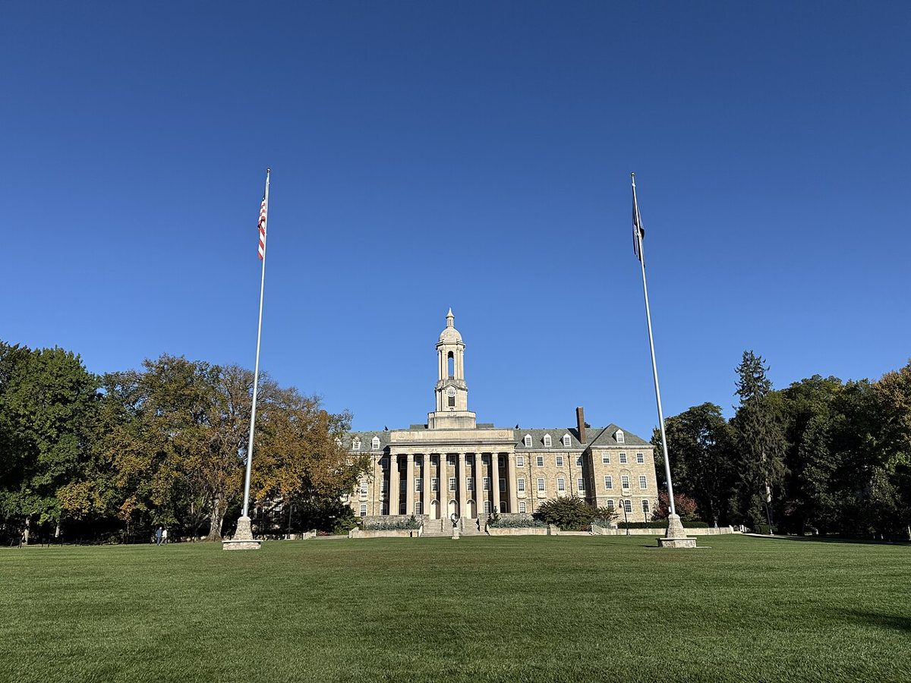
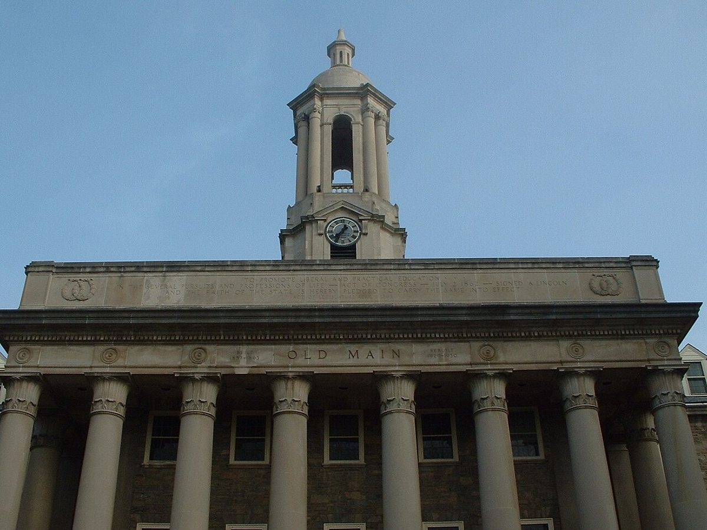
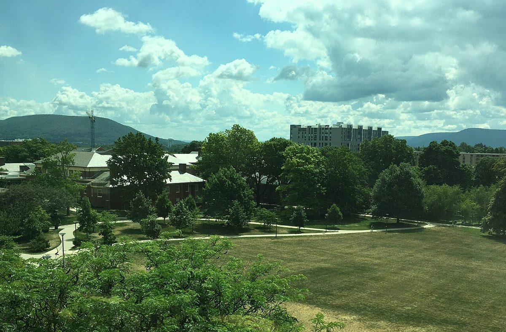
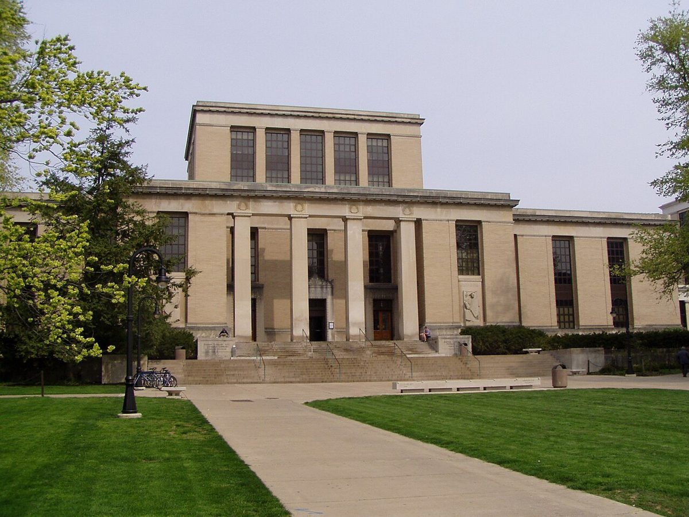
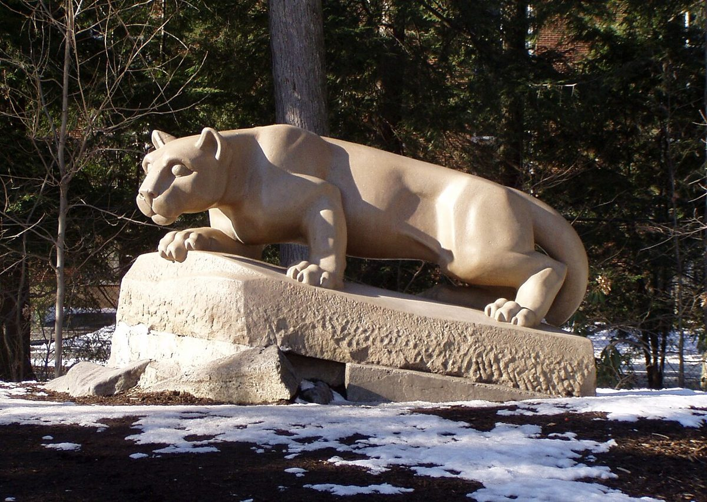
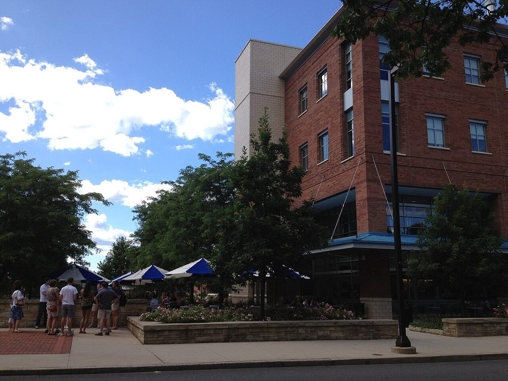
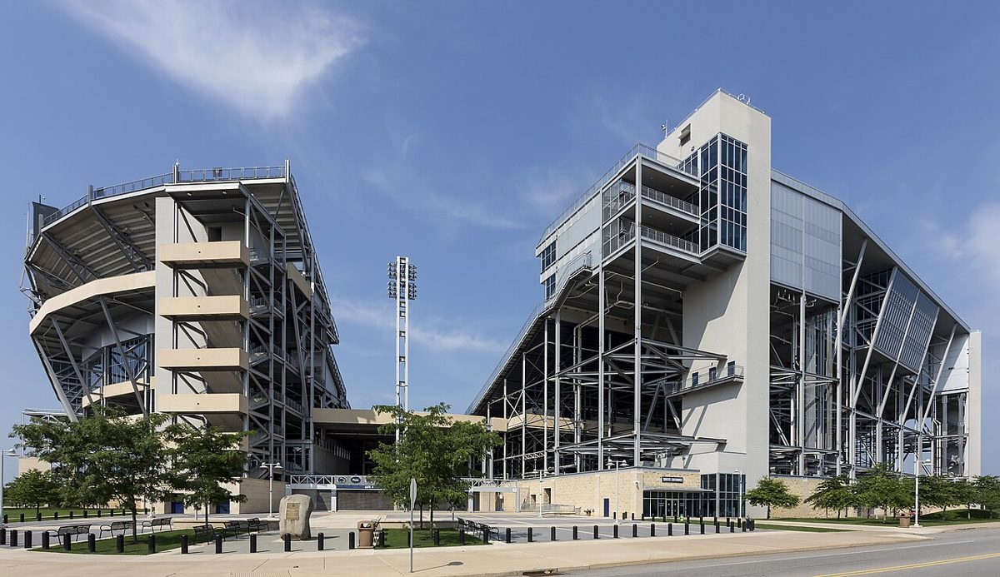
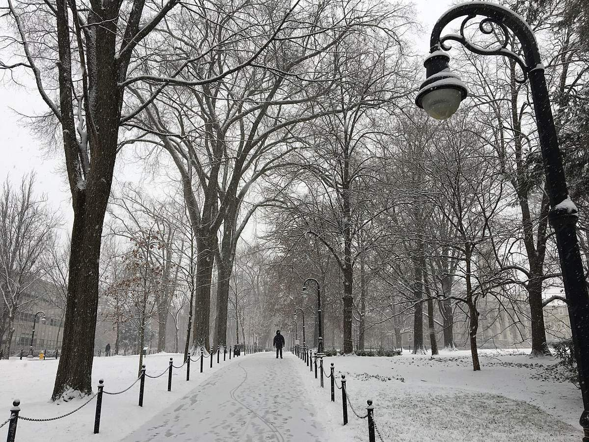
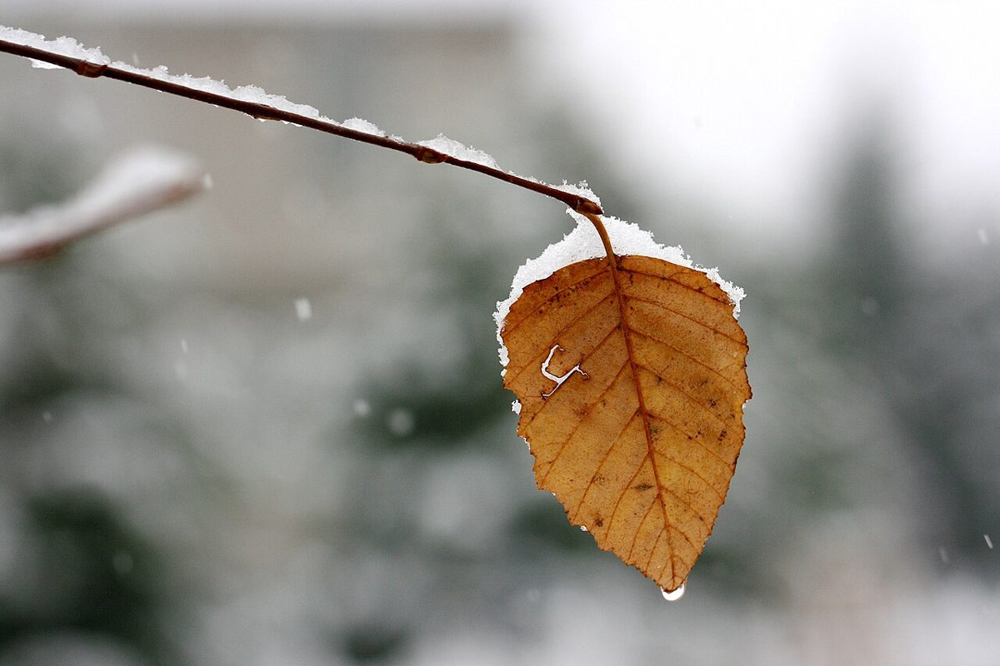

# Mood board: Happy Valley Grand Prix

Reference photos for the toy-box campus, in route order ([MAP.md](../MAP.md)). They show **what to keep from the real campus**: the silhouette, the main colors and one or two details. Everything else gets simplified into the toy style in the [art bible](../ASSETS.md#art-bible).

These are references for the team only. They never ship in the game, and every model stays original. All images come from Wikimedia Commons under free licenses, shrunk to 1200 px. Credits are at the bottom and in [ASSETS.md](../ASSETS.md#credits).

## 1. Start / finish: Old Main

- **Keep:** the symmetrical limestone front, six tall columns, the bell tower in the dead center, the two flagpoles framing it, and the huge open lawn in front. That lawn is our starting grid.
- **Colors:** limestone `#D9CBB0`, grey slate roof, deep blue sky, the first maple and gold trees at the edges.
- **Simplify:** the windows become deep, dark insets with no frames. The dormers become 3–4 chunky blocks on the roof.

- **Keep:** the tower as a **stack of four parts**: square clock base, open arched belfry with columns at the corners, a small dome, then a spike. Stretch it taller than real life (art bible: exaggerate).
- **Leave out:** the carved inscriptions and any real lettering.

## 2. Pollock Road and the HUB lawn, with Mount Nittany

- **Keep:** wide lawns crossed by **curving paths** (good S-curve shapes for Pollock Road), low brick buildings with pale grey roofs, round lollipop trees.
- **Mount Nittany:** a long, low, gently humped ridge, not a peak. One flat silhouette card in a hazy blue-green on the horizon is enough.

## 3. Library steps: Pattee Library

- **Keep:** stacked limestone boxes (a tall center block on a wide base), tall flat pilasters, **deep window insets**, and the wide run of steps across the whole front. The steps are the bouncing ramp section.
- **Toy idea:** the steps can be oversized and chunky, like building blocks, with the book-stack barriers at the sides.

## 4. Lion Shrine hairpin

- **Keep the idea, not the sculpture:** a big cat **crouching on a slanted rock slab**, low and long, looking out. Our lion is **original**: chunky low-poly, a different face and pose details, never a copy of this statue or the logo.
- **Colors:** sandy limestone against dark evergreens (pine `#2F5D3A`) makes the lion pop. Keep that contrast around the hairpin.

## 5. Creamery run

- **Keep:** red brick with pale stone trim, and the **blue and white patio umbrellas** out front. Those umbrellas read instantly as "the Creamery" and make great toy props.
- **Ours to invent:** the giant ice-cream cone ramp and the vanilla puddles. They don't exist here, so they set the playful tone for the section.

## 6. Beaver Stadium

- **Keep:** the stands leaning outward, the **exposed steel frame** and the pale concrete stair towers. Light towers are good vertical markers to see from the far side of the map.
- **Simplify:** the steel becomes a repeating segment of chunky beams (build one, instance it around the bowl), painted navy `#1E2F5C`.

## 7. Snowy Arboretum

- **Keep:** a straight path under bare trees, **black lamp posts with curly arms**, and short posts joined by chains along the edges. Those posts make perfect low barriers for the downhill.
- **Colors:** snow `#F4F6F8`, dark trunks, a soft grey-white sky. The light gets cooler and the fog thicker here (art bible: lighting).

## The color arc: fall into snow

- One picture of the whole lap's arc: a rust-orange leaf (maple `#E8742B`, gold leaf `#F2B33D`) catching the first snow. The race starts warm and ends cold.

## Style references (not stored here)

Their licenses are usually unclear, so the team looks these up instead of copying them into the repo. Useful searches:
- "painted wooden toy town" and "wooden play set village": chunky shapes, flat paint, bevelled edges
- "vintage toy race track" and "slot car track": track pieces, barriers, number plates
- "checkered flag race day graphics" and "race number board": the livery for the UI and signage

## Credits

| File | Original on Wikimedia Commons | Author | License |
|---|---|---|---|
| `01-old-main.jpg` | [Old Main at Pennsylvania State University from Old Main Lawn](https://commons.wikimedia.org/wiki/File:Old_Main_at_Pennsylvania_State_University_from_Old_Main_Lawn.jpeg) | Dough4872 | [CC BY-SA 4.0](https://creativecommons.org/licenses/by-sa/4.0) |
| `02-old-main-tower.jpg` | [Penn state old main bell tower](https://commons.wikimedia.org/wiki/File:Penn_state_old_main_bell_tower.jpg) | George Chriss | [CC BY 2.5](https://creativecommons.org/licenses/by/2.5) |
| `03-hub-lawn-mount-nittany.jpg` | [Penn State HUB Lawn and Mt Nittany Seen From HUB](https://commons.wikimedia.org/wiki/File:Penn_State_HUB_Lawn_and_Mt_Nittany_Seen_From_HUB.jpg) | JohnDziak | [CC BY-SA 4.0](https://creativecommons.org/licenses/by-sa/4.0) |
| `04-pattee-library.jpg` | [Pattee Library PSU](https://commons.wikimedia.org/wiki/File:Pattee_Library_PSU.jpg) | Nathaniel C. Sheetz | [CC BY-SA 3.0](https://creativecommons.org/licenses/by-sa/3.0) |
| `05-lion-shrine.jpg` | [Lion Shrine PSU](https://commons.wikimedia.org/wiki/File:Lion_Shrine_PSU.jpg) | Photo by Nathaniel C. Sheetz; sculpture by Heinz Warneke | [CC BY-SA 3.0](https://creativecommons.org/licenses/by-sa/3.0) |
| `06-berkey-creamery.jpg` | [Berkey Creamery at Penn State - panoramio](https://commons.wikimedia.org/wiki/File:Berkey_Creamery_at_Penn_State_-_panoramio.jpg) | adeans | [CC BY-SA 3.0](https://creativecommons.org/licenses/by-sa/3.0) |
| `07-beaver-stadium.jpg` | [Beaver Stadium Penn State PA1](https://commons.wikimedia.org/wiki/File:Beaver_Stadium_Penn_State_PA1.jpg) | Acroterion | [CC BY-SA 4.0](https://creativecommons.org/licenses/by-sa/4.0) |
| `08-campus-snow.jpg` | [Penn State University Park campus in the snow, January 2019](https://commons.wikimedia.org/wiki/File:Penn_State_University_Park_campus_in_the_snow,_January_2019.jpg) | JohnDziak | [CC BY-SA 4.0](https://creativecommons.org/licenses/by-sa/4.0) |
| `09-autumn-leaf-snow.jpg` | [A lone autumn leaf, covered with snow](https://commons.wikimedia.org/wiki/File:A_lone_autumn_leaf,_covered_with_snow_(6292482652).jpg) | photochem_PA, State College, PA | [CC BY 2.0](https://creativecommons.org/licenses/by/2.0) |

All images were resized and re-compressed (changed from the originals). Under the share-alike licenses, these resized copies keep the same license as their originals.
