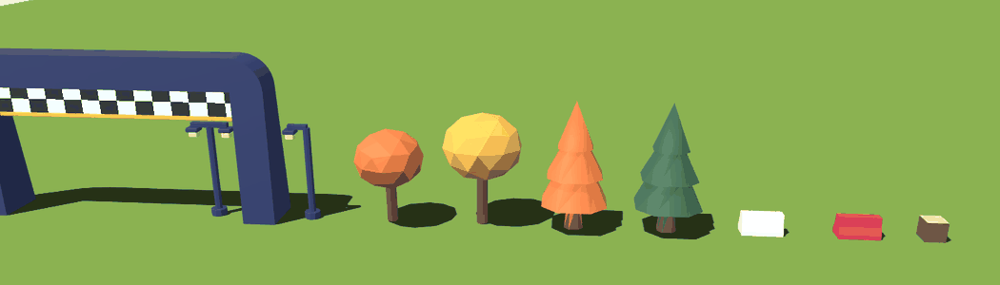

# Ali: Game guide

You own **the game**: how the ball moves, the race rules, the track, the items, and everything you see in 3D, including most **3D models** (the first four planets, the dressing kit, the landmarks a ball touches) and their pipeline. Nuris builds planets 5–8, the animated props, Beaver Stadium, the Mount Nittany backdrop and the event-to-effect table.

| Area | Where |
|---|---|
| Simulation: physics, race rules, items, track loading | `packages/game-core` |
| 3D rendering, cameras, VFX/audio hookup | `apps/web/src/game` |
| 3D models: balls, landmarks, props, dressing kit | Sources in Drive `RaceBall/assets-src/`, optimized into `apps/web/public/assets/` (`models/`, `maps/`, `tex/`, `mat/`) |
| Server hosting on Railway | `railway.json`, `apps/server/Dockerfile`, `.dockerignore`, the Railway dashboard |
| Map greybox + gameplay markers | `happy_valley.blend` (Drive), exported to `packages/game-core/tracks/` and `apps/web/public/assets/maps/` |

## How your work connects to the others

- **Rasim** runs your `game-core` inside the server's 60 Hz loop. He feeds it phone inputs, broadcasts your `snapshot()` to every screen, and routes your events to phones. His net library (`apps/web/src/net`) gives you interpolated ball transforms every frame.
- **Nuris** sets the look in the art bible ([ASSETS.md](../ASSETS.md)), reviews your models against it, and delivers particles and sounds into `apps/web/public/assets`. You fire those from gameplay events. Nuris's React UI (HUD, map, results) sits on top of your canvas.
- **The contract** is `packages/shared/src/protocol.ts`. Change it only through the [protocol process](../WORKFLOW.md#changing-the-protocol-packagessharedsrcprotocolts).

## Golden rules

1. **`game-core` is pure TypeScript:** no Babylon, no DOM, no network. It runs in Node (the server) and in the browser (local mode).
2. **Online, physics runs only on the server.** Screens never simulate. The exception is local mode (`?local=1`), which is for your own testing and tuning.
3. **Fixed timestep of 1/60 s.** Never pass a variable `dt` to Rapier.
4. **One coordinate system:** right-handed, Y up, +Z forward, meters. In Babylon, always set `scene.useRightHandedSystem = true` ([conventions](../WORKFLOW.md#units-and-coordinates)).
5. **Every feel number lives in `game-core/src/tuning.ts`.**

## Setup

Do [ONBOARDING.md](../ONBOARDING.md) first. Your packages (Rasim adds them in the bootstrap):

```bash
pnpm --filter @raceball/game-core add @dimforge/rapier3d-compat @gltf-transform/core gl-matrix
pnpm --filter @raceball/game-core add -D vitest
pnpm --filter @raceball/web add @babylonjs/core @babylonjs/loaders
pnpm --filter @raceball/web add -D @babylonjs/inspector lil-gui
```

Suggested layout:

```
packages/game-core/src/
  index.ts       public API (re-exports only)
  physics.ts     Rapier init + world creation
  race.ts        Race: players, phases, step, snapshot, events
  ball.ts        per-ball controls: steer/gas/brake → forces
  track.ts       loadTrack(): colliders + markers from the _col.glb
  items.ts       item logic + odds by position
  ranking.ts     progress + standings
  tuning.ts      every feel constant
packages/game-core/tracks/happy_valley_col.glb
packages/game-core/test/*.test.ts

apps/web/src/game/
  GameView.tsx   React component that owns the Babylon engine
  game.ts        createGame(scene, mode): meshes, cameras, update loop
  balls.ts       ball meshes + skins, updated from snapshots
  cameras.ts     chase camera, overview, follow-cam tiles
  assets.ts      loading asset containers with progress
  fx.ts          particles + sounds triggered by events
  local.ts       local mode: runs game-core in the browser with the keyboard
```

---

## M0: Setup

### 1. Rapier world and one ball (`physics.ts`, `ball.ts`)

```ts
import RAPIER from "@dimforge/rapier3d-compat";

export async function initPhysics() {
  await RAPIER.init();                       // loads the WASM once, before anything else
}

export function createWorld() {
  const world = new RAPIER.World({ x: 0, y: -9.81, z: 0 });
  world.timestep = 1 / 60;
  return world;
}

export function addBall(world: RAPIER.World, x: number, y: number, z: number) {
  const body = world.createRigidBody(
    RAPIER.RigidBodyDesc.dynamic()
      .setTranslation(x, y + 0.6, z)
      .setCcdEnabled(true)                   // fast balls must not tunnel through thin track pieces
      .setAngularDamping(0.4),
  );
  world.createCollider(
    RAPIER.ColliderDesc.ball(0.5)            // 1 m diameter (see ASSETS.md)
      .setFriction(1.0)
      .setRestitution(0.3)
      .setActiveEvents(RAPIER.ActiveEvents.CONTACT_FORCE_EVENTS),
    body,
  );
  return body;
}
```

Start with a flat ground (`RAPIER.ColliderDesc.cuboid(50, 0.1, 50)`) until the track loader exists.

### 2. Keyboard adapter (local mode only)

Turn W/S/A/D (or arrow keys) into the same `InputMsg` a phone sends:
- `gas = W ? 1 : 0`
- `brake = S`
- `steer` ramps toward -1 / +1 while A/D is held, so it feels like a wheel, not a switch
- `item = Space`

Everything downstream then can't tell the keyboard from a phone.

### 3. Babylon scene in React (`GameView.tsx`)

```tsx
import { useEffect, useRef } from "react";
import { Engine, Scene, Vector3, HemisphericLight } from "@babylonjs/core";
import "@babylonjs/loaders/glTF";
import { createGame } from "./game";

export function GameView({ mode }: { mode: "local" | "viewer" | "host" }) {
  const canvasRef = useRef<HTMLCanvasElement>(null);

  useEffect(() => {
    const engine = new Engine(canvasRef.current, true, { stencil: true });
    const scene = new Scene(engine);
    scene.useRightHandedSystem = true;       // match glTF + Rapier, no conversions
    new HemisphericLight("sky", new Vector3(0, 1, 0), scene);

    const game = createGame(scene, mode);
    engine.runRenderLoop(() => {
      game.update(engine.getDeltaTime() / 1000);
      scene.render();
    });
    const onResize = () => engine.resize();
    addEventListener("resize", onResize);
    return () => {
      removeEventListener("resize", onResize);
      game.dispose();
      engine.dispose();
    };
  }, [mode]);

  return <canvas ref={canvasRef} style={{ width: "100%", height: "100%", display: "block" }} />;
}
```

React StrictMode runs effects twice in development. The cleanup above disposes the first engine, so that's fine.

### 4. Chase camera v0 (`cameras.ts`)

The ball *rolls*, so never parent the camera to it. Follow the **heading** instead:

```ts
// every frame: dt in seconds, ball = rendered ball position, h = heading
const fwd = new Vector3(Math.sin(h), 0, Math.cos(h));
const desired = ball.subtract(fwd.scale(t.camDistance)).add(new Vector3(0, t.camHeight, 0));
const k = 1 - Math.exp(-t.camStiffness * dt);    // smoothing that doesn't depend on frame rate
camera.position = Vector3.Lerp(camera.position, desired, k);
camera.setTarget(ball.add(fwd.scale(2)));
```

Use a `UniversalCamera` for this. Start with `camDistance = 6`, `camHeight = 3`, `camStiffness = 8`.

### 5. Inspector toggle (dev only)

```ts
addEventListener("keydown", async (e) => {
  if (!import.meta.env.DEV || !(e.shiftKey && e.code === "KeyI")) return;
  await import("@babylonjs/inspector");
  scene.debugLayer.isVisible() ? scene.debugLayer.hide() : scene.debugLayer.show({ embedMode: true });
});
```

**Done when:** `/play?local=1` shows a ball you drive with the keyboard, the chase camera follows it, and Shift+I opens the Inspector.

### 6. Deploying the server to Railway

**You own Railway end to end:** the project, the service settings, deploys and logs, and the files it builds from. Rasim owns the server code; it listens on `process.env.PORT` and answers `/health`. Do this once the bootstrap PR is merged.

**Current setup (done):**

| | |
|---|---|
| Project / service | `raceball` / `raceball-server`, deploying `main` of `raceball/raceball` (Railway's GitHub app has access to the `raceball` org) |
| Domain | `raceball-server-production.up.railway.app` (port 2567), so `VITE_SERVER_URL=wss://raceball-server-production.up.railway.app` |
| Variables | `PORT=2567`, so the server listens on the port the domain points to |
| Plan | **Free** for now: the server sleeps when idle and Railway placed it in `sfo`, even though `railway.json` asks for US East |
| Before M1's latency measurement and the event | Upgrade to **Hobby** (railway.com > workspace settings > Plans), then set Region to US East and turn app sleeping off |

**Files in the repo** (already added by the bootstrap PR; they sit at the repo root so the Docker build can see the workspace packages).

`apps/server/Dockerfile`:

```dockerfile
FROM node:24-slim
WORKDIR /app
RUN corepack enable
COPY . .
RUN pnpm install --frozen-lockfile && pnpm --filter @raceball/server build
ENV NODE_ENV=production TRACK_PATH=/app/packages/game-core/tracks/happy_valley_col.glb
# Railway sets PORT itself. The server must listen on process.env.PORT (default 2567 locally)
CMD ["node", "apps/server/dist/index.js"]
```

`.dockerignore`:

```
**/node_modules
**/dist
.git
apps/web/public/assets
```

`railway.json` (config as code, so the settings live in git; check field names against Railway's "Config as Code" reference):

```json
{
  "$schema": "https://railway.com/railway.schema.json",
  "build": {
    "builder": "DOCKERFILE",
    "dockerfilePath": "apps/server/Dockerfile",
    "watchPatterns": ["apps/server/**", "packages/**", "pnpm-lock.yaml"]
  },
  "deploy": {
    "healthcheckPath": "/health",
    "restartPolicyType": "ON_FAILURE",
    "multiRegionConfig": { "us-east4-eqdc4a": { "numReplicas": 1 } }
  }
}
```

**Steps:**
1. Sign in at railway.com with GitHub.
2. New Project > Deploy from GitHub repo. Authorize Railway for `raceball/raceball`, then select it.
3. **In the service settings:**
   - **Root Directory:** leave it **empty**, so Railway builds from the repo root and sees the whole workspace.
   - **Builder:** taken from `railway.json`. Without it, set the variable `RAILWAY_DOCKERFILE_PATH=apps/server/Dockerfile`, spelled exactly like that.
   - **Region:** US East (Virginia).
   - **Replicas:** exactly **1**. Rooms live in memory, so a second replica would split players into different rooms.
   - **Serverless / app sleeping:** **off**, so the server never sleeps.
   - **Networking:** Generate Domain, targeting port 2567. Ours is `raceball-server-production.up.railway.app`.
4. **Push to `main`.** Railway builds and deploys on its own. After that, every push that touches the watch paths redeploys the server. Doc and asset changes don't.
5. **Check:** `curl https://raceball-server-production.up.railway.app/health` should return `ok`. Logs are under the service's Deployments tab.
6. **Optional CLI** (`npm i -g @railway/cli`): `railway login`, `railway link` (pick the project), `railway logs`, and `railway up` (a manual deploy from your machine).

**Cost:**
- **Now:** the Free plan, $0. It gives $1 of usage per month, about three weeks of our idle server. It also allows only 1 project and 1 project member.
- **From the M1 latency measurement through the event:** Hobby, $5/month with $5 of usage included, which one small Node service fits in.
- **After the event:** delete the project (Project Settings > Danger, then Delete Immediately), or keep it if we want to keep playing.

**Fallback (Fly.io):** if Railway ever causes trouble, the same Dockerfile runs on Fly.io in `iad` (Ashburn). That needs `flyctl`, a `fly.toml` with `internal_port = 2567`, `auto_stop_machines = "off"`, `min_machines_running = 1`, and exactly one machine (`fly scale count 1`).

**Done when:** `curl https://raceball-server-production.up.railway.app/health` returns `ok`.

---

## M1: Vertical slice

### 1. Ball control model (`ball.ts`)

Run this once per tick for each player, **before** `world.step()`:

```ts
export function applyControls(p: PlayerSim, input: InputMsg, dt: number, t: Tuning, world: RAPIER.World) {
  const v = p.body.linvel();
  const speed = Math.hypot(v.x, v.z);
  const mass = p.body.mass();
  const grounded = isGrounded(p, world);
  const control = grounded ? 1 : t.airControl;

  // 1. Steering turns the heading, a bit less at high speed. steer > 0 = right = heading decreases
  const turnRate = t.turnRate * (1 - t.turnFalloff * Math.min(speed / t.maxSpeed, 1));
  p.heading -= input.steer * turnRate * dt;
  const fwd = { x: Math.sin(p.heading), z: Math.cos(p.heading) };

  // 2. Gas pushes along the heading, with no push above max speed
  if (input.gas > 0 && speed < p.maxSpeed) {
    const j = t.engineForce * input.gas * control * dt;
    p.body.applyImpulse({ x: fwd.x * j, y: 0, z: fwd.z * j }, true);
  }

  // 3. Grip removes part of the sideways speed, so the ball follows the heading
  //    (grip 0 = pure marble, high = on rails). Surfaces like ice cream and ice lower it
  const side = { x: fwd.z, z: -fwd.x };
  const lateral = v.x * side.x + v.z * side.z;
  const kGrip = 1 - Math.exp(-t.grip * p.surfaceGrip * control * dt);
  p.body.applyImpulse({ x: -side.x * lateral * kGrip * mass, y: 0, z: -side.z * lateral * kGrip * mass }, true);

  // 4. Brake damps horizontal speed
  if (input.brake) {
    const kBrake = 1 - Math.exp(-t.brakeStrength * dt);
    p.body.applyImpulse({ x: -v.x * kBrake * mass, y: 0, z: -v.z * kBrake * mass }, true);
  }
}

function isGrounded(p: PlayerSim, world: RAPIER.World) {
  const ray = new RAPIER.Ray(p.body.translation(), { x: 0, y: -1, z: 0 });
  // exclude our own body from the ray (last argument)
  return world.castRay(ray, 0.5 + 0.15, true, undefined, undefined, undefined, p.body) !== null;
}
```

Starting tuning values (`tuning.ts`):

| Name | Start | Meaning |
|---|---|---|
| `maxSpeed` | 18 m/s | Top speed on flat ground |
| `engineForce` | 25 | Acceleration strength |
| `turnRate` | 2.4 rad/s | Heading change at full steer |
| `turnFalloff` | 0.4 | Turn rate drops by 40% at top speed |
| `grip` | 6 | How quickly sideways sliding is removed |
| `brakeStrength` | 3 | How quickly the brake stops you |
| `airControl` | 0.2 | Share of control while airborne |

### 2. Greybox the route in Blender

**Done, and generated from code.** `tools/track/build_happy_valley.py` builds the whole greybox in Blender:
- the 8 sections as one closed loop: a 12 m road with rails, library steps, a banked Lion Shrine hairpin with a jump, the Creamery cone climb, the stadium tunnel and the Arboretum downhill
- every marker
- landmark boxes and a few Kenney props
- it saves `assets-src/happy_valley.blend` and exports both `.glb` files

**Numbers:** the centerline is 1,096 m. An autopilot at full gas laps in about 63 s with no falls, so players should land in the 60–75 s window.

**To change the map:**
- Edit the script (route knots in `KNOTS`, `SCALE`, `WIDTH`, landmark positions).
- Re-run it, either in Blender's Scripting tab, or through the Blender MCP add-on (`exec` the file with `RACEBALL_ROOT` set to the repo path). It only replaces its own "Happy Valley" scene.
- **Edits made by hand in the `.blend` are lost on the next run**, so keep the route in the script.
- After a run, `pnpm --filter @raceball/game-core test` checks the export ("happy_valley_col.glb is raceable").
- Upload the new `.blend` to the Drive folder.

**Playtest:** `/play?local=1` now plays Happy Valley:
- `&map=flat` gives the flat test ground, `&view=overview` starts zoomed out, and `&ball=mars` picks your planet (default Earth).
- **R** resets, and **V** toggles the overview camera.
- The HUD times each lap from the checkpoint gates.

The manual steps below are what the script automates.

1. Open `happy_valley.blend` from Drive. Import Kenney Marble Kit pieces (File > Import > glTF 2.0).
2. Lay out the 8 sections from [MAP.md](../MAP.md) with track pieces. Use **boxes for landmarks**, roughly the final size. Turn on increment snapping so pieces line up.
3. Put collision meshes in the `collision` collection, named `*_col`. Keep them simple: a few hundred triangles per section is plenty.
4. Add markers as Empties in the `markers` collection, using the [marker table](../ASSETS.md#blender-is-our-level-editor):
   - `spawn_1..8` sit just behind `cp_00`. `cp_00` is the finish line.
   - Checkpoints use **Cube** display with size 1. Scale the Empty to the gate size, since the scale becomes the half-extents.
   - Put a `section` custom property on checkpoints (e.g. `"creamery"`). Overtake events and the standings use it.
5. Export `collision` + `markers` to `packages/game-core/tracks/happy_valley_col.glb`, and the `visual` collection to `apps/web/public/assets/maps/happy_valley.glb`. Settings:
   - glTF Binary
   - +Y Up
   - Include > Custom Properties
   - Limit to: Visible Objects (hide the other collections)
6. Playtest in local mode. Iterate until one lap takes 60–75 s and feels good.

### 3. Track loader (`track.ts`)

**Done.** `loadTrack(world, glb, io)` reads `happy_valley_col.glb` (`io`: `new NodeIO()` on the server, `new WebIO()` in the browser), and `createRace(glb, io, { laps })` builds a race on it.

- **Markers** (nodes with an `rb` custom property; see the [marker table](../ASSETS.md#blender-is-our-level-editor)) come back in `TrackData`, in world space:
  - `spawns` sorted by slot, `checkpoints` sorted by index
  - `respawns`, `items`, `boosts`, `surfaces`, `cameras`
  - `path`: the `route` marker's centerline, a closed loop of [x, z] points from the finish line, the racing way. `path.ts` measures along it (`project`, `pointAt`), and the race exposes the points as `race.path` for the big-screen `TrackMap`. `tools/track/build_happy_valley.py` writes it, about every 4 m.
  - Headings come from each marker's rotation.
- **Checkpoint gates and boost pads** become sensor boxes sized by the Empty's scale. **Surfaces** become a sensor from the mesh's convex hull. Each one keeps its Rapier collider handle, for the lap and boost logic.
- **Every other mesh** becomes a solid trimesh with the node's world matrix applied, built with Rapier's `FIX_INTERNAL_EDGES` so balls don't bump on the seams between triangles. Optional `friction` (default 1) and `restitution` (default 0) custom properties on a `*_col` object change how it plays, e.g. bouncier library steps.
- **`checkTrack(track)`** lists what makes a track unraceable: not exactly slots 1–8, a gap in the checkpoint indices, fewer than 2 checkpoints, or a checkpoint without a respawn. `createRace` itself only refuses a track with no spawns, so a half-built greybox still loads in local mode.
- **Tests** (`src/track.test.ts`) build a synthetic track in memory with gltf-transform. The test "happy_valley_col.glb is raceable" switches on by itself once you export the greybox to `packages/game-core/tracks/`, and runs `checkTrack` on it.

### 4. Respawn

**Done** (`race.ts`). A ball respawns when its `y < -10` (`fallY`), or when it's **stuck**: the player holds gas while the ball moves slower than `stuckSpeed` (1 m/s) for `stuckSeconds` (5 s). That covers a ball wedged against a wall, caught in a gap, or pinned in a pile-up.

The plan was "no progress toward the next checkpoint for 5 s". On Happy Valley's Lion Shrine hairpin, though, the road heads away from the next gate for 54 m, so that rule would respawn anyone slower than about 11 m/s there.

When a ball respawns:
1. It's teleported to the respawn marker of the **last gate it crossed**. If that gate has no marker, the nearest earlier gate's marker is used. Before the first gate, it goes back to its grid slot. Its speed and spin are zeroed.
2. Its heading is set to the marker's forward direction.
3. `{ type: "respawn" }` is emitted.

**Gate progress:** each ball tracks the next gate from Rapier collision events (`world.step(eventQueue)`). Only the next gate counts, so shortcuts and driving backwards don't move a ball's respawn point. Laps and ranking (M2) build on the same `next`/`last` fields.

### 5. Agree the `game-core` API with Rasim

```ts
export async function initPhysics(): Promise<void>;
export async function createRace(trackGlb: Uint8Array, io: PlatformIO, cfg: { laps: number }): Promise<Race>;

export interface Race {
  addPlayer(id: string, ball: string): void;      // takes the next free spawn slot
  removePlayer(id: string): void;
  setInput(id: string, input: InputMsg): void;    // latest wins; the server handles staleness
  start(countdownMs: number, laps: number): void; // lobby → countdown → racing. laps = 1 (demo) or 3
  step(dt: number): void;                         // always 1/60
  snapshot(tick: number, t: number): SnapMsg;
  drainEvents(): GameEvent[];                     // events since the last call
  standings(): Standing[];                        // id, place, lap, checkpoint, finishedAt
  readonly phase: Phase;
  // bots, for Rasim's fill-up and load tests:
  botInput(id: string): InputMsg;                 // steer toward the next checkpoint, full gas
}
```

Commit the types first, even with a stub implementation, so Rasim can build the server loop against them in parallel.

### 6. Render server snapshots

Rasim's net library exposes something like `net.sample(now)`, which returns `Map<id, { p, q, h }>` for other balls (interpolated) and your own ball (extrapolated). Each frame:

- **New id:** create the ball mesh by cloning that player's skin. **Removed id:** dispose it.
- `mesh.position.set(...p)`, `mesh.rotationQuaternion = new Quaternion(...q)`
- The chase camera uses your own ball's `p` and `h`.

**How it's wired:** `game/net-feed.ts` (`NetFeed`) turns a `NetSession` into the renderer's `BallFeed`: poses from `session.sample()`, and each ball's planet and color from `session.state.players` (no planet picked = `PLANETS[color]`, as on the server). `createGame(scene, "viewer" | "host", { session })` loads the Happy Valley map. The laptop chase-follows its own ball, and the big screen starts on the overview camera (`V` toggles). `game/Online.tsx` is the minimal M1 flow on `/play` and `/host`. The laptop shows `ViewerJoin`, then the game with the pairing QR in a corner, and reports `assetsLoaded` once the map is in. The big screen's room card has the lap choice, Add bot and Start (enabled by `canStart`). Rasim's M2 lobby replaces those screens, and the game side stays `<GameView mode session />`.

**Run it end to end locally:** `pnpm dev` (web, pad and server), open `/host`, then `/play?room=CODE` in a second window, and scan the QR with a phone on the same Wi-Fi. Without a phone, a script can join as the pad with the laptop's `pairToken` and send `input` messages at 60 Hz. With 50–80 ms of added delay (65 ms round trip), the chase camera's jerk stayed under 0.1 m and 0.05° per frame, lower than following raw snapshots.

### 7. Tuning workflow

Tuning **only works in local mode**, because online the physics runs on the server.

1. Open `/play?local=1`. A `lil-gui` panel edits the live `tuning` object.
2. When it feels right, copy the values into `tuning.ts` and commit.
3. Rasim redeploys the server.

**Done when:** a phone steers your ball through the deployed server on a laptop, and the delay is measured (see TASKS.md).

---

## M2: Full race

### Checkpoints, laps and ranking

**Done** (`race.ts`, tested in `rules.test.ts` on a synthetic loop and on Happy Valley):
- **Laps:** only the next gate counts. Crossing `cp_00` after the last gate completes a lap and emits `lap` (the lap just started, 2 … laps); the last one emits `finish` with the place. The first crossing of `cp_00` starts the race.
- **Ranking:** finishers by `finishedAt`, then everyone else by `progress`, the meters along the route from the start line. Within a lap that's the distance past the last gate crossed, clamped to the next gate, so a shortcut or reversing never gains a place. Tracks without a route use straight lines between gates.
- **Standings:** `{ id, place, lap, checkpoint, finishedAt, progress }`, where `lap` is the lap being raced (1 … laps) and `checkpoint` is the last gate crossed in order (0 = the finish line).
- **End:** `results` when everyone is in, or `finishGraceSeconds` after the winner. Finished balls ignore input from then on.
- **Bots:** `botInput(id)` aims at a point ahead on the route (`botLookahead…` in `tuning.ts`), full gas, braking only when that point is far off to the side at speed. It laps Happy Valley in 65 s with no respawns.

How it works:
- Step with an event queue:

  ```ts
  const q = new RAPIER.EventQueue(true);
  world.step(q);
  q.drainCollisionEvents((h1, h2, started) => { /* ... */ });
  ```

- Map collider handles to a checkpoint index and a player. When the next checkpoint gets a `started` event:
  - advance that player's `nextCheckpoint`
  - crossing `cp_00` after the last checkpoint completes a lap
  - out-of-order hits are ignored, which stops shortcuts across the map and driving backwards
- `progress = lap * N + checkpointsThisLap + (1 - distToNext / segmentLength)`. Sort by progress, descending. Finished players sort by `finishedAt`.
- The race ends when everyone has finished, or 30 s after the winner.

### Race phases
- `lobby`: no physics, balls parked on their spawns.
- `countdown`: physics runs, inputs are ignored. Balls sit on the grid.
- `racing`
- `results`: freeze inputs, and let balls roll to a stop.

### Collisions and bump events

**Done** (`race.ts`, tested in `rules.test.ts`):
- **Bump:** ball colliders report contact forces over `bumpForceMin` (50 N); a ball-to-ball one becomes `{ type: "bump", a, b, strength }` with `strength = force / bumpBigHit` (600 N), at most once per pair per `bumpCooldown` (0.25 s). Measured: a 12 m/s rear-end hit is about 370 N (strength 0.6), and pushing contact stays under 20 N, so it never counts. Contact with the track never counts.
- **Overtake:** the race keeps the unfinished racers in order and emits `{ type: "overtake", player, passed, section }` when one gets `overtakeGap` (1 m) ahead of the racer in front, with the section of the overtaker's last gate. The gap stops side-by-side balls from flickering.
- **Feel:** the physics is unchanged (equal masses, restitution 0.3). Try `setRestitution(0.5)` at the next playtest if bumps feel flat; it also makes landings a little bouncier.

Notes:
- Ball-to-ball: `setRestitution(0.5)` feels bouncy. Use the same mass for every ball, unless an item changes it.
- Set a contact force threshold on ball colliders (`setContactForceEventThreshold`). Then in `q.drainContactForceEvents(e => ...)`, emit `bump` with `strength = clamp(e.totalForceMagnitude() / BIG_HIT, 0, 1)` for both balls.
- **Overtake:** compare the standings order with the previous tick. Emit `overtake` with the section of the checkpoint where it happened.

### Own-ball extrapolation (with Rasim)
- Draw your own ball at `latest.p + latest.v * age`, where `age = serverNow - latest.t`, capped at 150 ms.
- When a new snapshot disagrees, blend the error away with `1 - exp(-15 * dt)` per frame. Never snap.

### Big-screen cameras
- **Overview camera:** fly between the `cam_*` markers, or frame the leading pack with a high camera that keeps everyone in view. Pick whichever reads better on the projector.
- **Follow-cam tiles for phone-only players**, up to 4:

  ```ts
  tile.viewport = new Viewport(0.75, 0.75, 0.25, 0.25);   // x, y, width, height (0–1, y from the bottom)
  scene.activeCameras = [overview, ...tiles];
  ```

- If `engine.getFps() < 50` for 3 s, drop the tiles and show name tags instead. Every tile draws the scene again, so this is the safety valve.

**How it's built** (`game/big-screen.ts`, `game/TileFrames.tsx`):

- **Overview:** frames the whole pack. It eases toward the middle of every ball and backs off 1.2 m per metre of spread, plus 30 m (at least 45 m, at most the whole map). The angle stays where it is.
- **Tiles:** the first 4 phone-only players in join order. The page draws Nuris's `FollowTile` frames along the top and measures the inside of each one. The game then draws that player's `ChaseCamera` in the matching viewport. Babylon clears only depth before each extra camera, so every tile scissor-clears its own rectangle first. Without that, the tile's sky would show the overview underneath.
- **Fallback:** `FpsGuard` ignores the 2 s after the tiles change (new render passes compile shaders), then trips after 3 s in a row under 50 fps. The tiles go for good, and every ball gets a billboard name tag (player color dot, name) that stays the same size on screen at any zoom. Headless software rendering trips it after about 12 s, so expect it on a weak projector laptop.
- **Place on the tiles:** `FollowTile` hides the place while it's 0. It shows once the server syncs standings into the schema.

**Done when:** 4+ players (laptop and phone-only, real or bots) finish 3 laps in the correct order.

---

## M3: Happy Valley and items

### Items (`items.ts`)

| Item | Effect | Starting numbers |
|---|---|---|
| Blue & White Boost | Impulse along the heading, plus a higher `maxSpeed` for a while | +8 m/s, `maxSpeed` x1.5 for 1.5 s |
| Lion Roar | Radial impulse on every other ball within range, with falloff | 6 m radius, 12 N·s at the center |
| Creamery Spill | Spawn a puddle sensor 2 m behind you for 10 s. Inside it, `surfaceGrip = 0.2` | Puddle radius 2 m |
| Snow Day (stretch) | Every ball ahead of you gets `maxSpeed` x0.7 for 3 s | |

- **Item boxes:** a sensor at each `item` marker. When hit, give an item if the slot is empty, then hide the box for 5 s. Its active state goes in Rasim's schema (`itemBoxes`).
- **Odds by place:**

  | Place | Boost | Roar | Spill | Snow Day |
  |---|---|---|---|---|
  | 1st | 20% | 40% | 40% | 0% |
  | Middle | 45% | 35% | 20% | 0% |
  | Last two | 50% | 20% | 0% | 30% |

  Tune these after playtests.

### Section mechanics

| Section | How to build it |
|---|---|
| Library steps | Real step geometry in the collision mesh, plus higher restitution on that collider |
| Lion Shrine hairpin | A banked collision mesh. The jump is just a ramp, with a checkpoint on the landing so it stays legal |
| Creamery cone | A ramp in the collision mesh. Puddles are `surface` markers (`grip = 0.2`) |
| Beaver Stadium | Geometry only. Its checkpoint has `section = "stadium"` |
| Snowy Arboretum | `surface` markers: snow (`grip = 0.6`, plus extra damping) and ice (`grip = 0.1`) |
| College Ave | `boost` markers: a sensor that adds an impulse along the pad's forward direction |

### Hooking up assets, VFX and audio
- Load assets with `LoadAssetContainerAsync(url, scene)` while in the lobby, and report the progress to Nuris's loading UI. Call `container.addAllToScene()` at race start.
- **Particles:** `ParticleSystem.Parse(json, scene, "/assets/fx/")`. Set `emitter` to the ball mesh, then `start()` and `stop()` them from events.
- **Sounds:** trigger them from the same events. Give the rolling loop a pitch of `0.8 + speed / maxSpeed * 0.6`.
- **The `fx.ts` table is Nuris's** (M3): each event's particles and sound, from her VFX files and sound bank. You call it from the event stream in `game.ts`, and add the camera shake in your camera polish.

### Performance pass (target: 60 fps on the demo laptops)
- **Inspector > Statistics:** keep draw calls under 150.
- **Static scenery:**
  - `mesh.freezeWorldMatrix()`
  - `scene.freezeActiveMeshes()` after loading, unfreezing when needed
  - `material.freeze()`
- **Repeated props:** `mesh.createInstance()`, or thin instances for hundreds of copies.
- **Shadows:** **one** `DirectionalLight` with a `ShadowGenerator(2048)`. Only balls and big landmarks cast shadows.
- **LOD** on landmarks: `mesh.addLODLevel(distance, lowMesh)`.
- **Merge** static meshes that share a material: `Mesh.MergeMeshes`.

### Camera polish
- Widen the FOV slightly at speed.
- Add a small shake on bumps and roars, which turns off when reduced motion is set in the settings.
- Do a quick swoop over the grid during the countdown.

---

## Assets: 3D models and pipeline

You build the first four planets, the track dressing kit and the landmarks a ball touches (Old Main, Lion Shrine, Creamery + cone, Pattee Library). **Nuris builds** planets 5–8, the animated props, Beaver Stadium and the Mount Nittany backdrop with the same scripts and pipeline ([her guide](nuris-art-ui.md#m3-models-and-effects-taken-over-from-ali)); check that anything of hers a ball touches still matches the collision. **Nuris's art bible in [ASSETS.md](../ASSETS.md) sets the style**, so ask Nuris to review each of your models before it's merged.

### M0: Kenney track and prop packs
Download and look through the **Kenney Marble Kit** and **Racing Kit** (both CC0). Add the track pieces and props you'd use to the shortlist in ASSETS.md. Put the downloads in `assets-src/packs/` in Drive.

### M0: Run one asset through the whole pipeline
Do this with one ball and one track piece, so the pipeline is proven before real work starts.

**Done:** the planet balls and `models/trk_road_straight.glb` went through it. Both are built by scripts in `tools/models/`, so the Blender steps below are automated for them. The Babylon Sandbox site isn't reachable from the cloud sessions, so they were checked in headless Babylon renders (the same engine) instead.

1. **Blender:**
   - 1 unit = 1 m. The ball is a 1 m diameter UV sphere, 5k triangles or fewer.
   - Apply the transforms (Ctrl+A > All Transforms).
   - Origin at the base center for props. Origin at the center for balls.
2. **Export:** File > Export > glTF 2.0:

   | Setting | Value |
   |---|---|
   | Format | glTF Binary (`.glb`) |
   | Include | Limit to **Selected Objects** (or Visible), **Custom Properties** on |
   | Transform | **+Y Up** on |
   | Data > Mesh | Apply Modifiers on, UVs on, Normals on |
   | Data > Material | Export |
   | Animation | On, only if the asset is animated |
   | Compression | Off (we compress in the next step) |

3. **Optimize:**

   ```bash
   gltf-transform optimize ball_earth.glb ball_earth.opt.glb --compress meshopt --texture-compress webp
   # with toktx installed you can use --texture-compress ktx2 instead
   gltf-transform inspect ball_earth.opt.glb    # check triangles, textures, size
   ```

4. **Check:** drag the optimized file into the Babylon Sandbox. Look at the scale (compare it with a 1 m cube), the materials, normals (no black or inside-out faces) and any animations.
5. **Commit:** rename it to the final name, without `.opt`, and place it in the right folder (e.g. `apps/web/public/assets/models/ball_earth.glb`). Add a credits line in ASSETS.md, then open a PR with a Sandbox screenshot.

### M0: Drive folder
Create the folders:
- `RaceBall/assets-src/`, containing `models/`, `maps/` (`happy_valley.blend` lives here), `textures/`, `audio/`, `packs/` and `reference/`
- `RaceBall/exports/`, for files you want to share before they're optimized

Share the folder with Nuris and Rasim.

### M1: Planet balls (first 4: Earth, Mars, Jupiter, Saturn)

**Done, and generated from code.** `tools/models/build_planet_balls.py` builds all four in Blender:
- a 1 m UV sphere (about 3k triangles) with one material and a painted 1024×512 texture, in the colors of `packages/shared/theme/theme.css`
- the `ring` (1.5k triangles): white with ink edges as vertex colors, so tinting `mat_player_color` gives the player color and keeps the edges dark
- it saves `assets-src/models/planet_balls.blend` and the raw GLBs. Then optimize each one:

  ```bash
  gltf-transform optimize assets-src/models/ball_earth.glb apps/web/public/assets/models/ball_earth.glb \
    --compress meshopt --texture-compress webp --simplify false
  ```

- Run it in Blender's Scripting tab, through the MCP add-on, or headless (`blender -b -P tools/models/build_planet_balls.py`). To add a planet, give it a base color and details in `PLANETS`, then add it to `PLANET_MODELS` in `apps/web/src/game/balls.ts`.

**In the game,** `BallViews` (`apps/web/src/game/balls.ts`) loads each planet once and clones it per ball. The planet rolls inside a node that only follows the position, and that node holds the ring, tinted with the player's color from `PLAYER_COLORS`. A feed tells it each ball's planet and color slot through `look(id)`; Rasim's net feed can pass `ball` and `color` from the player state. Planets without a model show the striped placeholder, with the ring.

**Meshopt decoder:** Babylon loads it from its CDN the first time a compressed model loads, until Rasim self-hosts the decoders (M3).
- **The balls are the eight planets.** Looks, colors and details are in the [art bible](../ASSETS.md#balls-the-eight-planets): flat paint and 1–3 details, no photo textures.
- **One material per planet.** Textures are 1024² at most, or paint the details with vertex colors.
- **File names:** `models/ball_earth.glb`, `ball_mars.glb`, `ball_jupiter.glb`, `ball_saturn.glb`.
- **The orbit ring** is a separate mesh in the same file (`ring`), with material `mat_player_color` that you tint in code. In the scene, parent it to a node that **follows the ball's position but not its rotation**, so it floats level while the planet rolls. It isn't part of the collider.

### M1: Track dressing kit
Barriers, fall trees (2–3 variants), lamp posts, benches, the start/finish arch, ground tiles.

**Done, and generated from code.** `tools/models/build_dressing_kit.py` builds `models/kit_dressing.glb`: 9 props, each its own node at the origin, all on **one** material (`mat_palette`) and one 256×256 palette texture of the art bible colors.



| Prop | Size | Triangles | Made from |
|---|---|---|---|
| `prop_finish_arch` | 16 m wide, 8.5 m tall | 340 | Kenney `overhead` in navy, plus our checkered banner and flag-yellow trim |
| `prop_lamp_single`, `prop_lamp_double` | 5 m | 628, 844 | Ours, navy with warm lamps (until Kenney's `lightPost*` are in reach) |
| `prop_tree_round_gold`, `prop_tree_round_maple` | 5.6 m, 4.8 m | 300 each | Ours: chunky leaning "lollipops" |
| `prop_tree_maple`, `prop_tree_pine` | 6.5 m | 80 each | Kenney `tree-large`, recolored |
| `prop_barrier_red`, `prop_barrier_white` | 2 m | 28 each | Kenney `barrierRed`; alternate them along the track |

- **Kenney pieces** come from `assets-src/packs` when the kits are there, and are otherwise cut out of `maps/happy_valley.glb`, which already holds them. Either way they're recolored onto the palette.
- **The same script** builds `models/trk_road_straight.glb`, a 10 m stretch of the 12 m road with chalk lines and red and white curbs, with its top at y = 0.
- **To change the kit:** edit the script, re-run it (Blender's Scripting tab, the MCP add-on, or `blender -b -P`), then optimize. Keep the props as separate nodes:

  ```bash
  gltf-transform optimize assets-src/models/kit_dressing.glb apps/web/public/assets/models/kit_dressing.glb \
    --compress meshopt --texture-compress webp --simplify false --join false --flatten false --instance false --palette false
  ```

- **Sky:** `tex/env_happy_valley.env` is a Poly Haven sky HDRI (CC0), prefiltered into a 256 px cube with Babylon's `CreateEnvTextureAsync`. `game.ts` loads it as `scene.environmentTexture` at `SKY_FILL` (0.6), with the hemispheric light turned down to 0.3.
- **Next:** place the props along the route in `tools/track/build_happy_valley.py` (or instance them in code from the kit), and add the rest of the shortlist (fences, rails, `flagCheckers`) once the packs are in reach.

**Use one shared palette texture:** a small image (e.g. 256×256) of color swatches. UV each prop onto the swatches it needs, and give **every prop the same material**. Hundreds of props then cost a handful of draw calls instead of hundreds. This is the most important performance trick for an asset-heavy scene.

**Lighting:** one HDRI from Poly Haven (CC0), converted to Babylon's `.env` format (the Babylon Sandbox or IBL tools can do this), saved as `tex/env_happy_valley.env`.

### M3: Landmark order and budgets
From [MAP.md](../MAP.md).

| Order | Landmark | Owner | Triangle budget | Notes |
|---|---|---|---|---|
| 1 | Old Main + start/finish arch | Ali | 25k | The judges see this first. Bell tower silhouette |
| 2 | Lion Shrine | Ali | 8k | Original low-poly lion on a rock |
| 3 | Creamery + giant cone | Ali | 15k | The cone is also a ramp. Match your collision shape |
| 4 | Beaver Stadium bowl + tunnel + scoreboard prop | Nuris | 40k total | Build one stand segment and instance it around the bowl. The tunnel walls are collision, so model over them |
| 5 | Pattee Library facade + steps | Ali | 12k | Steps must line up with the collision steps |
| 6 | Mount Nittany backdrop | Nuris | Card or texture | A far-away silhouette layer, not real geometry |

### M3: How to model over the greybox
1. Open `happy_valley.blend` in Drive. Your greybox boxes and collision meshes are there.
2. Model each landmark **in place over its box**, in the `visual` collection. Don't touch `collision` or `markers`.
3. Anything a ball can touch (ramps, steps, the cone) must match the collision shape. If you want a different shape, change the collision first.
4. Use the shared palette texture where you can. Only hero pieces (Old Main, the lion, the cone) get their own textures.
5. Export the `visual` collection to `apps/web/public/assets/maps/happy_valley.glb`, optimize it, check the size, commit.

### M3: Planets 5–8 and animated props (Nuris)
Moved to [Nuris's guide](nuris-art-ui.md#m3-models-and-effects-taken-over-from-ali). You still play the animations by name in code and load new planets through `PLANET_MODELS` in `balls.ts`.

### Before you commit a model

- [ ] Named by the convention (`trk_`, `prop_`, `ball_`, `mat_`)
- [ ] Real-world scale (1 unit = 1 m) and the origin in the right place
- [ ] Within its triangle and texture budget (`gltf-transform inspect`)
- [ ] Optimized (Meshopt + WebP/KTX2)
- [ ] Checked in the Sandbox (scale, normals, materials, animations)
- [ ] Reviewed by Nuris against the art bible
- [ ] Credits line in ASSETS.md, task ticked in TASKS.md

**Model pitfalls:** unapplied scale (physics and visuals stop matching), too many materials (use the palette texture), 4K textures (2048² is the maximum), and official Penn State logos (never, even on small props).

---

## Testing

- **Vitest (`pnpm --filter @raceball/game-core test`):**
  - crossing checkpoints in order counts a lap
  - out-of-order crossings don't count
  - ranking order
  - respawn
  - item odds sum to 100%
  - a bot finishes a lap on the real track within 2 minutes
- **Local mode** for feel. **Online with Rasim's bots** for the full race flow.

## Pitfalls

- **Forgetting `scene.useRightHandedSystem = true`:** everything ends up mirrored, or rotations go wrong.
- **Tuning while online:** your sliders change nothing, because the server simulates. Use `?local=1`.
- **The ball tunnels through thin track:** make sure CCD is on, and thicken the collision mesh rather than the visuals.
- **Huge trimesh colliders:** keep collision meshes simple. They're not the visuals.
- **Marker properties missing:** they must be on the Blender *object* (Object Properties pane), and "Custom Properties" must be ticked on export.
- **Calling `RAPIER` before `await RAPIER.init()`** crashes with a WASM error.

## Who to ask

- **Rasim:** server loop, net library, phones, deploys, bots.
- **Nuris:** the art bible, reviews of your models, particles, sounds, and how the UI reads race state.
